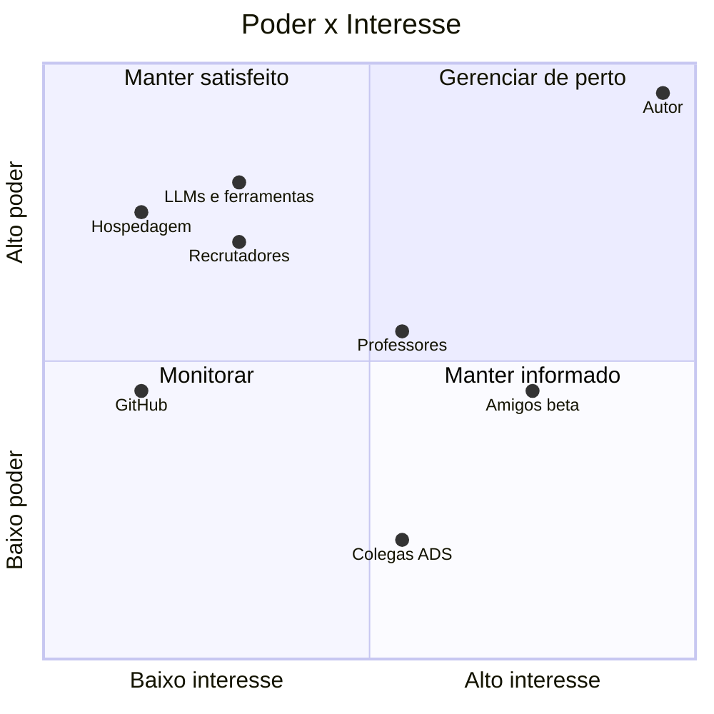

# Registro de Stakeholders — Outfit Lab

| Campo | Valor |
|---|---|
| Documento | Registro de Stakeholders (partes interessadas) |
| Versão | 1.0 |
| Data | 13/11/2026 |
| Autor | Cauã Gama Paixão |
| Gerado por | PROMPT-001 v2.0 |
| Status | Em revisão |

### Histórico de revisões

| Versão | Data | Autor | Alteração |
|---|---|---|---|
| 1.0 | 13/11/2026 | Cauã Gama Paixão | Versão inicial. |

---

## 1. Tailoring

No PMBOK clássico, este registro traz contatos, cargos e uma matriz de engajamento "atual × desejado" por pessoa. Aqui os stakeholders são **grupos** (não há como prever cada amigo ou recrutador), a escala de interesse/influência é qualitativa (Baixo/Médio/Alto) e o engajamento desejado aparece junto da estratégia. Isso basta para um projeto solo de 7 semanas.

## 2. Registro

| ID | Stakeholder | Tipo | Interesse | Influência | Expectativas | Estratégia de engajamento |
|---|---|---|---|---|---|---|
| STK-01 | **Cauã Gama Paixão** (autor) | Interno | Alto | Alto | App útil para si, portfólio forte, domínio de vibe coding, prazo cumprido. | Gerenciar de perto: é patrocinador, PM, PO, dev e QA. Revisão semanal do cronograma e dos riscos ao fim de cada sprint. |
| STK-02 | **Amigos beta testers** | Externo | Médio → Alto (cresce se o app for útil) | Médio (o feedback deles muda prioridades na SPR-06) | App simples, rápido, que não perca os dados; privacidade das fotos; poder dar opinião. | Manter informados e engajados: convite pessoal, onboarding curto, grupo de mensagens, formulário de feedback de 3 minutos, retorno sobre o que foi corrigido. |
| STK-03 | **Professores de ADS** | Externo | Médio | Médio (avaliação acadêmica, indicação, conselhos) | Uso correto de engenharia de software (requisitos, PMBOK, testes, arquitetura). | Manter satisfeitos: mostrar a documentação e o repositório em marcos-chave (M1 e M7); pedir feedback pontual. |
| STK-04 | **Colegas de ADS** | Externo | Médio | Baixo | Ver o projeto, aprender com o processo, talvez testar. | Monitorar: compartilhar o README e posts de progresso; potencial fonte extra de beta testers. |
| STK-05 | **Recrutadores / empresas** | Externo | Baixo agora → Alto ao ver o portfólio | Alto (decisão de contratação) | README claro, deploy funcionando, código organizado, testes, histórico de commits consistente. | Manter satisfeitos: tratar o README como vitrine, releases bem descritas, link do deploy sempre funcionando, posts no LinkedIn (opcional). |
| STK-06 | **LLMs / ferramentas de IA** (geradora e revisora) | Ferramenta | — | Alto (qualidade e velocidade da entrega dependem delas) | Contexto claro e completo (AGENTS.md, PRD, prompt da tarefa). | Gerenciar como ferramenta: prompts versionados, AGENTS.md sempre atualizado, revisão cruzada, nunca aceitar código sem entender. |
| STK-07 | **Provedores de hospedagem** (front, API, banco, imagens) | Fornecedor | Baixo | Alto (limites, cold start, mudanças de plano gratuito) | Uso dentro dos termos e limites do plano. | Monitorar: acompanhar painéis de uso semanalmente durante o beta; ter plano B documentado no Guia de Kickoff Técnico. |
| STK-08 | **GitHub** (repositório, Actions, Pages, Projects) | Fornecedor | Baixo | Médio | Uso dentro dos limites gratuitos. | Monitorar minutos de Actions; manter repositório público para ter Actions e Pages gratuitos [VERIFICAR limites]. |

## 3. Matriz Poder × Interesse

**Leitura:**
- **Gerenciar de perto:** o autor. Óbvio, mas registrar ajuda a lembrar que o maior risco do projeto é a própria disponibilidade.
- **Manter satisfeito:** recrutadores, provedores e LLMs. Têm poder alto e pouco interesse direto; o projeto se adapta a eles.
- **Manter informado:** amigos beta. O interesse é alto e o poder é moderado, mas eles definem se OBJ-02 e OBJ-03 serão cumpridos.
- **Monitorar:** colegas e GitHub.

## 4. Plano de engajamento por marco

| Marco | Stakeholders | Ação |
|---|---|---|
| M1 (16/11) | Professores (opcional) | Compartilhar documentação PMBOK e protótipos. |
| M4 (07/12) | Amigos — onda 1 (2 a 3 pessoas) | Convite para testar cadastro e guarda-roupa em produção. |
| M6 (21/12) | Amigos — todos | Convite para o fluxo completo + formulário de feedback. |
| M7 (31/12) | Recrutadores, professores, colegas | Release v1.0, README final, post no LinkedIn (opcional). |

---

## 📚 Por que este documento existe

Projetos falham mais por pessoas do que por tecnologia. Este registro obriga a pensar em **quem** é afetado pelo projeto e **o que cada um espera**. Aqui, ele deixa claro que os amigos são decisivos para o beta e que recrutadores vão julgar o projeto pelo README. Isso orienta onde investir tempo.
