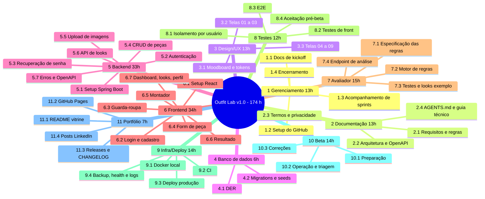

# EAP (WBS) e Dicionário da EAP — Outfit Lab v1.0

| Campo | Valor |
|---|---|
| Documento | Estrutura Analítica do Projeto e Dicionário |
| Versão | 1.1 |
| Data | 13/11/2026 |
| Autor | Cauã Gama Paixão |
| Gerado por | PROMPT-001 v2.0 |
| Status | Em revisão |
| Referências | `01_Declaracao_de_Escopo.md` · `03_Cronograma_e_Marcos.md` |

### Histórico de revisões

| Versão | Data | Autor | Alteração |
|---|---|---|---|
| 1.0 | 13/11/2026 | Cauã Gama Paixão | Versão inicial. |
| 1.1 | 13/11/2026 | Cauã Gama Paixão | Caminhos atualizados para a convenção de pastas D-25 e prompts previstos renumerados (+1) — PROMPT-002. |

---

## 1. Tailoring e premissas de estimativa

- A EAP é **orientada a entregas** e tem 2 níveis (pacote → pacote de trabalho). Um terceiro nível vira issue no GitHub.
- **As horas são do autor**, não da LLM: escrever o prompt, ler e entender o código gerado, pedir explicações, testar, corrigir, integrar e documentar. A geração em si é rápida; a revisão é que consome tempo.
- As estimativas são de **ordem de grandeza** (±30%). Elas serão recalibradas no fim da SPR-01 com as horas reais.
- Cada pacote aponta o **prompt previsto** que vai gerá-lo. PROMPT-003 a 011 são os previstos no PROMPT-001; os números de PROMPT-012 em diante são sugestões e podem ser renumerados.

## 2. Diagrama da EAP

## 3. Dicionário da EAP

Legenda MoSCoW: **M** Must · **S** Should · **C** Could.

### 1 Gerenciamento do projeto — 13 h

| Código | Pacote | Entregável | Critério de aceite | Dependências | Horas | MoSCoW | Prompt |
|---|---|---|---|---|---|---|---|
| 1.1 | Documentação de kickoff (PMBOK) | PRD v1.1, TAP, stakeholders, escopo, EAP, cronograma, riscos, qualidade, comunicação/beta, decisões, índice | Documentos revisados e aprovados pelo autor | PRD v1.0 | 6 | M | PROMPT-001 (A) |
| 1.2 | Setup do GitHub | Projects (Kanban), labels, milestones M1–M7, templates de issue | Board com as 15 primeiras issues; templates funcionando | 2.4 | 2 | M | PROMPT-007 |
| 1.3 | Acompanhamento de sprints | Relatório semanal em `d_execucao/` (feito, horas, riscos, decisões) | 1 relatório por sprint (SPR-01 a 06) | — | 3 | M | — (template) |
| 1.4 | Encerramento | Lições aprendidas, release notes v1.0, relatório final do beta | Arquivos em `e_encerramento/` | 10.3 | 2 | M | PROMPT-020 |

### 2 Documentação técnica e de produto — 13 h

| Código | Pacote | Entregável | Critério de aceite | Dependências | Horas | MoSCoW | Prompt |
|---|---|---|---|---|---|---|---|
| 2.1 | Requisitos detalhados e regras de negócio | RF/RNF/RN detalhados com critérios de aceite; taxonomia de categorias e atributos por categoria | Cada RF com critério de aceite testável; pontos [EM ABERTO] 4, 5, 6 e 8 do PRD resolvidos | 1.1 | 4 | M | PROMPT-003 |
| 2.2 | Arquitetura e contratos da API | Diagrama de componentes, pacotes, `openapi.yaml` | Todos os endpoints do MVP descritos com request/response e erros | 2.1, 4.1 | 4 | M | PROMPT-006 |
| 2.3 | Termos de uso e política de privacidade | Página estática no app + Markdown no repositório | Cobre dados coletados, finalidade, retenção, exclusão e contato | 2.1 | 2 | M | PROMPT-012 |
| 2.4 | AGENTS.md e Guia de Kickoff Técnico | `AGENTS.md`, `08_Guia_de_Kickoff_Tecnico.md`, estrutura de `a_tech_repo/` | Stack e hospedagem decididas; backlog inicial com 15 issues | 1.1 | 3 | M | PROMPT-001 (C) |

### 3 Design/UX — 13 h

| Código | Pacote | Entregável | Critério de aceite | Dependências | Horas | MoSCoW | Prompt |
|---|---|---|---|---|---|---|---|
| 3.1 | Análise do moodboard e design tokens | `00_Analise_do_Moodboard.md`, `design_tokens.md`, `tokens.css`, `tokens.ts` | Regra 60/30/10 documentada; contrastes AA verificados | Moodboard | 4 | M | PROMPT-001 (B) |
| 3.2 | Specs e protótipos TELA-01 a 03 | 3 specs + 3 HTMLs navegáveis | Checklist B5 do PROMPT-001 respondido | 3.1 | 4 | M | PROMPT-001 (B) |
| 3.3 | Specs e protótipos TELA-04 a 09 | 6 specs + 6 HTMLs | Mesmo checklist; telas do avaliador coerentes com 7.1 | 3.1, 2.1 | 5 | M | PROMPT-004 |

### 4 Banco de dados — 6 h

| Código | Pacote | Entregável | Critério de aceite | Dependências | Horas | MoSCoW | Prompt |
|---|---|---|---|---|---|---|---|
| 4.1 | DER | Modelo conceitual e lógico (Mermaid `erDiagram`) + dicionário de dados | Toda tabela de domínio tem `usuario_id` ou chega ao usuário por FK | 2.1 | 3 | M | PROMPT-005 |
| 4.2 | Migrations e seeds | Scripts Flyway `V1__...sql` + seed de cores/categorias | Schema criado do zero sem erro no Docker e no CI | 4.1, 9.1 | 3 | M | PROMPT-005 |

### 5 Backend (Java + Spring Boot) — 33 h

| Código | Pacote | Entregável | Critério de aceite | Dependências | Horas | MoSCoW | Prompt |
|---|---|---|---|---|---|---|---|
| 5.1 | Setup Spring Boot | Projeto base, perfis `local`/`prod`, conexão MySQL, `/actuator/health` | Sobe local com Docker; health retorna `UP` | 2.4, 9.1 | 3 | M | PROMPT-007 |
| 5.2 | Autenticação e cadastro | Cadastro, login, logout, hash de senha, allowlist do beta | Testes de cadastro válido/inválido, login e acesso negado sem credencial | 5.1, 4.2 | 7 | M | PROMPT-008 |
| 5.3 | Recuperação de senha | Solicitar reset, e-mail com token, redefinir senha (back + front) | Token de uso único, expira em 30 min; resposta igual para e-mail existente ou não | 5.2 | 5 | S | PROMPT-013 |
| 5.4 | CRUD de peças | Endpoints de peça com validação por categoria | Testes de criação, edição, exclusão e listagem filtrada | 5.2, 4.2 | 6 | M | PROMPT-009 |
| 5.5 | Upload de imagens | Upload com limites (formato, tamanho), armazenamento local/produção | Arquivo inválido retorna 400 com mensagem clara; imagem servida só ao dono | 5.4 | 5 | M | PROMPT-009 |
| 5.6 | API de looks | Salvar, listar, consultar e excluir looks com peças e funções | Testes de CRUD; look não aceita peça de outro usuário | 5.4 | 5 | M | PROMPT-014 |
| 5.7 | Erros padronizados e OpenAPI | Handler global (formato único de erro), Swagger UI em `local` | Todos os erros seguem o formato; Swagger reflete os contratos | 2.2, 5.4 | 2 | M | PROMPT-006/009 |

### 6 Frontend (React) — 34 h

| Código | Pacote | Entregável | Critério de aceite | Dependências | Horas | MoSCoW | Prompt |
|---|---|---|---|---|---|---|---|
| 6.1 | Setup React | Projeto Vite, tokens importados, rotas, `AuthLayout` e `AppShell` | Build sem erro; lint passando; layout em 375 e 1440 px | 2.4, 3.1 | 4 | M | PROMPT-007 |
| 6.2 | TELA-01/02 Login e cadastro | Telas integradas à API | Fluxos e estados das specs funcionando | 6.1, 5.2, 3.2 | 5 | M | PROMPT-008 |
| 6.3 | TELA-03 Guarda-roupa | Grid, busca, filtros, estados | Paridade com o protótipo 03; estados vazio/carregando/sem resultado | 6.2, 5.4 | 6 | M (filtros modelagem/cor: S) | PROMPT-009 |
| 6.4 | TELA-05 Cadastro/edição de peça | Formulário com upload e campos por categoria | Validação inline; erro de upload tratado | 6.3, 5.5, 3.3 | 5 | M | PROMPT-009 |
| 6.5 | TELA-06 Montador de look | Seleção de peças, funções/camadas, CTA "Analisar" | Não permite analisar look vazio; camadas identificadas | 6.3, 7.4 | 6 | M | PROMPT-015 |
| 6.6 | TELA-07 Resultado da análise | Pontuação, critérios, pontos positivos/atenção, "Salvar look" | Nenhuma nota exibida sem justificativa | 6.5, 5.6 | 3 | M | PROMPT-015 |
| 6.7 | TELA-04/08/09 Dashboard, looks salvos, perfil | Telas mínimas | Atalhos funcionam; looks listados; trocar senha e sair | 6.6 | 5 | S (looks salvos: M) | PROMPT-016 |

### 7 Avaliador de looks — 15 h

| Código | Pacote | Entregável | Critério de aceite | Dependências | Horas | MoSCoW | Prompt |
|---|---|---|---|---|---|---|---|
| 7.1 | Especificação das regras | Regras atômicas (RN-xx), dados necessários, dados ausentes, pesos e fórmula | Cada regra com entrada, saída, peso e justificativa em texto | 2.1 | 4 | M | PROMPT-010 |
| 7.2 | Motor de regras | Módulo de domínio puro (sem Spring/JPA) | Cada regra isolada numa classe/função testável | 7.1, 5.4 | 5 | M (estilo: S) | PROMPT-010 |
| 7.3 | Testes e looks de exemplo | Testes unitários por regra + ≥ 10 looks com resultado esperado | 100% das regras com teste; CI verde | 7.2 | 4 | M | PROMPT-010 |
| 7.4 | Endpoint de análise | `POST` de análise retornando pontuação + justificativas | Só aceita peças do usuário; resposta segue o contrato | 7.2, 5.6 | 2 | M | PROMPT-010 |

### 8 Testes — 12 h

| Código | Pacote | Entregável | Critério de aceite | Dependências | Horas | MoSCoW | Prompt |
|---|---|---|---|---|---|---|---|
| 8.1 | Testes de isolamento por usuário | Testes de integração: usuário B não lê/edita/exclui peças e looks de A | Cobre todos os endpoints de peça, imagem, look e análise | 5.5, 5.6, 7.4 | 3 | M | PROMPT-009/014 |
| 8.2 | Testes de frontend | Vitest + Testing Library nos formulários e no montador | Validações e estados críticos cobertos | 6.5 | 3 | M | PROMPT-015 |
| 8.3 | E2E do fluxo principal | Playwright: cadastro → peça → look → análise → salvar | Roda no CI | 6.6 | 4 | C | PROMPT-017 |
| 8.4 | Aceitação pré-beta | Roteiro manual executado em produção | Todos os itens da PRD seção 14 verificados | 9.3, 6.6 | 2 | M | PROMPT-011 |

### 9 Infraestrutura e deploy — 14 h

| Código | Pacote | Entregável | Critério de aceite | Dependências | Horas | MoSCoW | Prompt |
|---|---|---|---|---|---|---|---|
| 9.1 | Docker Compose local | `docker-compose.yml` com MySQL 8 | `docker compose up` sobe o banco; `.env.example` documentado | 2.4 | 2 | M | PROMPT-007 |
| 9.2 | CI (GitHub Actions) | Workflow de build + testes (back e front) em push/PR | PR com teste falhando fica bloqueado | 5.1, 6.1 | 3 | M | PROMPT-007 |
| 9.3 | Deploy em produção | Front, API, banco e imagens publicados com HTTPS | App acessível por link; segredos só no provedor | 6.4, 5.5 | 6 | M | PROMPT-011 |
| 9.4 | Backup, health check e logs | Backup diário, restauração testada, monitor de health, logs acessíveis | Restauração executada 1 vez com sucesso antes do beta | 9.3 | 3 | M | PROMPT-011 |

### 10 Beta com amigos — 14 h

| Código | Pacote | Entregável | Critério de aceite | Dependências | Horas | MoSCoW | Prompt |
|---|---|---|---|---|---|---|---|
| 10.1 | Preparação | Lista de convidados, allowlist, onboarding, formulário, selo "Beta" | Convites enviados (onda 1 e onda 2) | 9.4, 2.3 | 2 | M | PROMPT-011 |
| 10.2 | Operação e triagem | Issues `beta-feedback` triadas; comunicação de manutenção | 100% do feedback triado em até 48 h | 10.1 | 4 | M | — (processo) |
| 10.3 | Correções do feedback | Correções priorizadas (bugs primeiro) | Bugs críticos corrigidos antes de 31/12 | 10.2 | 8 | M | PROMPT-018+ (um por correção relevante) |

### 11 Portfólio — 7 h

| Código | Pacote | Entregável | Critério de aceite | Dependências | Horas | MoSCoW | Prompt |
|---|---|---|---|---|---|---|---|
| 11.1 | README vitrine | README raiz com badges, GIF/screenshots, link do deploy, arquitetura, "Como rodar" | Um recrutador entende o projeto em 1 minuto | 9.3 | 3 | M | PROMPT-019 |
| 11.2 | GitHub Pages com protótipos | Pages servindo `b_doc_repo/c_design/d_prototipos/` | Link funcionando no README | 3.2 | 1 | M | PROMPT-001 (C) |
| 11.3 | Releases e CHANGELOG | Tags por marco, `v1.0.0`, `CHANGELOG.md` | Release com notas por marco | — | 1 | M | — |
| 11.4 | Posts no LinkedIn | 2–3 posts de progresso | Publicados | 9.3 | 2 | C | — |

## 4. Totais

| Pacote | Horas | Must | Should | Could |
|---|---|---|---|---|
| 1 Gerenciamento | 13 | 13 | — | — |
| 2 Documentação | 13 | 13 | — | — |
| 3 Design/UX | 13 | 13 | — | — |
| 4 Banco | 6 | 6 | — | — |
| 5 Backend | 33 | 28 | 5 (5.3) | — |
| 6 Frontend | 34 | 30 | 4 (filtros extras ≈1, dashboard/perfil ≈3) | — |
| 7 Avaliador | 15 | 13 | 2 (perfil de estilo) | — |
| 8 Testes | 12 | 8 | — | 4 (8.3) |
| 9 Infra/Deploy | 14 | 14 | — | — |
| 10 Beta | 14 | 14 | — | — |
| 11 Portfólio | 7 | 5 | — | 2 (11.4) |
| **Total** | **174** | **157** | **11** | **6** |

> Must + Should = **168 h**. Comparação com a capacidade e plano de cortes: `03_Cronograma_e_Marcos.md`, seções 5 e 6.

---

## 📚 Por que este documento existe

A EAP quebra o "fazer o Outfit Lab" em pedaços pequenos o bastante para **estimar, atribuir e verificar**. Regra prática: se um pacote não cabe numa sprint ou não tem critério de aceite claro, ele ainda está grande demais. Aqui ela também liga cada pacote ao prompt que vai gerá-lo, o que garante a rastreabilidade do vibe coding.
