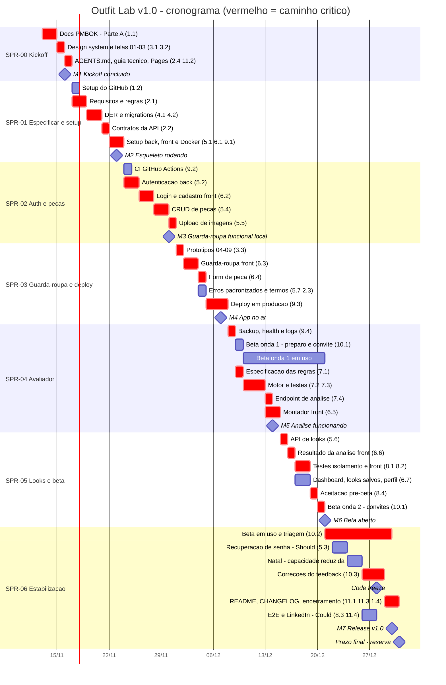

# Cronograma e Marcos — Outfit Lab v1.0

| Campo | Valor |
|---|---|
| Documento | Cronograma, marcos, capacidade e plano de cortes |
| Versão | 1.2 |
| Data | 13/11/2026 |
| Autor | Cauã Gama Paixão |
| Gerado por | PROMPT-001 v2.0 |
| Status | Em revisão |
| Referências | `02_EAP_e_Dicionario.md` · `04_Registro_de_Riscos.md` |

### Histórico de revisões

| Versão | Data | Autor | Alteração |
|---|---|---|---|
| 1.0 | 13/11/2026 | Cauã Gama Paixão | Versão inicial. |
| 1.1 | 13/11/2026 | Cauã Gama Paixão | Caminhos atualizados para a convenção de pastas D-25 e prompts previstos renumerados (+1) — PROMPT-002. |
| 1.2 | 13/11/2026 | Cauã Gama Paixão | Prompts previstos renumerados (+1) porque o PROMPT-003 passou a ser o das telas no Figma (D-33). |

---

## 1. Tailoring

- Sprints de **1 semana**, de terça a segunda (SPR-00 começa numa sexta, 13/11, e SPR-06 tem 10 dias para fechar no dia 31/12).
- Não há cerimônias formais de Scrum. No fim de cada sprint, o autor faz uma revisão de 30 min (o que foi entregue, horas reais, riscos) e registra o resultado em `d_execucao/SPR-xx.md`.
- O caminho crítico é analisado como **corrente crítica** (ver seção 4): com um único desenvolvedor, o recurso (o autor) é a principal restrição, mais do que as dependências entre tarefas.

## 2. Calendário e feriados

| Data | Evento | Efeito considerado |
|---|---|---|
| 15/11 (dom) | Proclamação da República | Cai no fim de semana; sem efeito. |
| 20/11 (sex) | Dia Nacional de Zumbi e da Consciência Negra (feriado nacional) | Neutro: pode até liberar horas extras. |
| Final de nov./dez. | Provas e trabalhos finais do semestre [VERIFICAR calendário da faculdade] | Risco de queda de capacidade (RISK-18). |
| 24/12 (qui) e 25/12 (sex) | Véspera de Natal e Natal | Capacidade reduzida a quase zero. |
| 31/12 (qui) | Véspera de Ano-Novo / prazo final | Tratado como **reserva**: a release é planejada para **30/12**. |

## 3. Sprints, ajustes e marcos

| Sprint | Período | Foco | Pacotes da EAP | Marco |
|---|---|---|---|---|
| SPR-00 | 13–16/11 | Kickoff: docs PMBOK, design system, protótipos 01–03, AGENTS.md, guia técnico, Pages | 1.1, 2.4, 3.1, 3.2, 11.2 | **M1** Kickoff concluído — 16/11 |
| SPR-01 | 17–23/11 | **Especificar antes de gerar**: requisitos, DER, migrations, contratos da API; setup back + front + Docker; GitHub | 1.2, 2.1, 2.2, 4.1, 4.2, 5.1, 6.1, 9.1 | **M2** Esqueleto rodando — 23/11 |
| SPR-02 | 24–30/11 | CI, autenticação (back + front), CRUD de peças, upload | 9.2, 5.2, 6.2, 5.4, 5.5 | **M3** Guarda-roupa funcional local — 30/11 |
| SPR-03 | 01–07/12 | Protótipos 04–09, guarda-roupa e form de peça no front, erros padronizados, termos, **deploy** | 3.3, 6.3, 6.4, 5.7, 2.3, 9.3 | **M4** App no ar — 07/12 |
| SPR-04 | 08–14/12 | Backup/health, **beta onda 1**, avaliador v1 (spec, motor, testes, endpoint), montador | 9.4, 10.1, 7.1–7.4, 6.5 | **M5** Análise funcionando — 14/12 |
| SPR-05 | 15–21/12 | API de looks, resultado, looks salvos/dashboard/perfil, testes de isolamento e front, aceitação, **beta onda 2** | 5.6, 6.6, 6.7, 8.1, 8.2, 8.4, 10.1, 10.2 | **M6** Beta aberto — 21/12 |
| SPR-06 | 22–31/12 | Triagem e correções do beta, recuperação de senha (Should), README, release; Could se sobrar tempo | 10.2, 10.3, 5.3, 11.1, 11.3, 1.4, (8.3, 11.4) | **M7** Release v1.0 — **30/12** (prazo: 31/12) |

### 3.1 Ajustes em relação ao esqueleto do PROMPT-001 (e por quê)

1. **Autenticação no backend passou da SPR-01 para a SPR-02.** Em vibe coding, a qualidade do código gerado depende da qualidade da especificação. A SPR-01 fica com requisitos, DER e contratos da API (PROMPT-004, 006, 007), que alimentam todos os prompts seguintes. Gerar a autenticação antes do DER causaria retrabalho.
2. **Beta em duas ondas.** O esqueleto previa o beta só a partir de 21/12, o que deixaria ~10 dias de uso em pleno período de festas. Agora a **onda 1** (2 a 3 amigos, cadastro + guarda-roupa) começa em **10/12**, logo depois do backup estar pronto, e a **onda 2** (todos os convidados, fluxo completo) começa em **20–21/12**. Assim, bugs de cadastro/upload aparecem cedo.
3. **Recuperação de senha (Should) foi para a SPR-06.** Durante o beta vale o plano B (reset manual pelo autor). Isso libera a SPR-05, que está no caminho crítico.
4. **Release planejada para 30/12**, com o dia 31/12 como reserva. **Code freeze em 28/12**: depois disso, só correção de bug e documentação.
5. **Protótipos 04–09 (PROMPT-005) entram no início da SPR-03**, antes do formulário de peça. Se houver folga na SPR-02, adiantar.

## 4. Gantt e caminho crítico

Barras em vermelho (`crit`) = caminho crítico.

### 4.1 Caminho crítico

**Requisitos (2.1) → DER/migrations (4.1, 4.2) → contratos (2.2) → setup (5.1, 6.1) → autenticação (5.2, 6.2) → CRUD de peças (5.4) → upload (5.5) → protótipos 04–09 (3.3) → guarda-roupa/form (6.3, 6.4) → deploy (9.3) → backup (9.4) → avaliador (7.1–7.4) → montador (6.5) → API de looks (5.6) → resultado (6.6) → testes (8.1, 8.2) → aceitação (8.4) → beta onda 2 (10.1) → triagem/correções (10.2, 10.3) → README/release (11.1, 1.4).**

**Por que quase tudo é crítico?** Com um único desenvolvedor, as tarefas não correm em paralelo: qualquer atraso empurra tudo o que vem depois. As únicas tarefas com folga real são as que podem ser feitas "em qualquer brecha" (setup do GitHub, CI, termos, dashboard/perfil, recuperação de senha, Could). Por isso o controle do prazo depende de **proteger a capacidade semanal** e de **cortar escopo cedo**, não de reorganizar dependências.

## 5. Capacidade × esforço

### 5.1 Carga semanal — [EM ABERTO]

**Recomendação: 25 h/semana** (≈ 3,5 h/dia em média, por exemplo 2–3 h nos dias úteis + 6–8 h no fim de semana). **Decidir até 16/11** (fim da SPR-00). Abaixo disso, o escopo Must não cabe sem cortes estruturais (tabela abaixo).

Capacidade calculada com SPR-00 = 0,7 semana e SPR-06 = 1,12 semana (10 dias, descontados 24, 25 e 31/12).

| Carga semanal | Capacidade total | vs. Total EAP (174 h) | vs. Must + Should (168 h) | vs. Must (157 h) |
|---|---|---|---|---|
| 15 h | 103 h | −71 h | −65 h | −54 h ❌ |
| 20 h | 136 h | −38 h | −32 h | −21 h ❌ |
| **25 h (recomendado)** | **171 h** | **−3 h** | **+3 h** | **+14 h** ⚠️ |
| 30 h | 205 h | +31 h | +37 h | +48 h ✅ |

**Leitura honesta:** mesmo com 25 h/semana a folga é pequena. Com Must + Should, sobram 3 h (≈ 2%), enquanto o PMBOK costuma recomendar 10–15% de reserva para estimativas de ±30%. Portanto **a lista de cortes abaixo não é um plano B distante: provavelmente parte dela será usada**.

### 5.2 Carga por sprint (cenário 25 h/semana)

| Sprint | Capacidade | Carga planejada | Saldo |
|---|---|---|---|
| SPR-00 | 18 h | 18 h | 0 |
| SPR-01 | 25 h | 25,5 h | −0,5 |
| SPR-02 | 25 h | 26,5 h | −1,5 |
| SPR-03 | 25 h | 26,5 h | −1,5 |
| SPR-04 | 25 h | 25,5 h | −0,5 |
| SPR-05 | 25 h | 24,5 h | +0,5 |
| SPR-06 | 28 h | 27,5 h (inclui 6 h de Could) | +0,5 |
| **Total** | **171 h** | **174 h** | **−3 h** |

As sprints SPR-02 e SPR-03 estão levemente acima da capacidade. Se o atraso passar de 2 h no fim de qualquer sprint, aplicar o primeiro item ainda não usado da lista de cortes.

## 6. Plano de cortes (ordem pré-aprovada)

Cortar **na ordem**, um item por vez, até o saldo voltar a zero. Cada corte é registrado como decisão (D-xx) no Registro de Decisões.

| Ordem | Corte | MoSCoW | Horas recuperadas | Efeito |
|---|---|---|---|---|
| 1 | Posts no LinkedIn (11.4) → depois do dia 31/12 | Could | 2 h | Nenhum na v1.0. |
| 2 | E2E com Playwright (8.3) → v1.1 | Could | 4 h | Aceitação manual (8.4) cobre o fluxo. |
| 3 | Recuperação de senha por e-mail (5.3) → plano B manual | Should | 4 h (fica 1 h de script) | Amigo pede reset pelo grupo; autor redefine. |
| 4 | Filtros de modelagem e cor (6.3) → só categoria + busca | Should | 1 h | Guarda-roupa um pouco menos navegável. |
| 5 | Perfil de estilo no avaliador (7.2) → v1.1 | Should | 2 h | Análise só com cores e camadas/proporções. |
| 6 | Dashboard mínimo → redireciona para o guarda-roupa; perfil só com "Sair" e "Trocar senha" | Should | 3 h | Menos telas; fluxo principal intacto. |
| 7 | Protótipos 04–09 em média fidelidade (sem painel de estados completo) | Must (parcial) | 2 h | Menos referência visual para o front. |
| 8 | Beta: onda única a partir de 20/12 | Must (parcial) | 1 h | Menos tempo de feedback. |
| | **Total recuperável sem tocar no fluxo principal** | | **19 h** | |

**Linha vermelha (não se corta):** RF-01 a RF-12 no nível Must, isolamento por usuário com testes, testes do avaliador, deploy com HTTPS, backup, termos/privacidade.

Se, mesmo após os 8 cortes, o saldo continuar negativo (cenário de 20 h/semana), a decisão deixa de ser de escopo e vira de **prazo ou carga**: aumentar as horas semanais nas SPR-02 e SPR-03 ou registrar formalmente que o beta (OBJ-02/03) termina em janeiro, mantendo a v1.0 publicada em 31/12.

## 7. Marcos

| Marco | Data | Critério de verificação | Release/tag |
|---|---|---|---|
| M1 Kickoff concluído | 16/11 | Partes A, B e C do PROMPT-001 aprovadas e commitadas | `v0.1.0` |
| M2 Esqueleto rodando | 23/11 | `docker compose up` + back + front sobem; CI configurado; DER e OpenAPI aprovados | `v0.2.0` |
| M3 Guarda-roupa funcional local | 30/11 | Cadastro, login e CRUD de peças com imagem funcionando localmente | `v0.3.0` |
| M4 App no ar | 07/12 | Link HTTPS público com cadastro, login e guarda-roupa | `v0.4.0` |
| M5 Análise funcionando | 14/12 | Montar look e receber análise com testes de regras verdes | `v0.5.0` |
| M6 Beta aberto | 21/12 | Fluxo completo em produção; aceitação 8.4 aprovada; convites da onda 2 enviados | `v0.9.0-beta` |
| M7 Release v1.0 | 30/12 (prazo 31/12) | Critérios do TAP (seção 11) verificados | `v1.0.0` |

---

## 📚 Por que este documento existe

O cronograma transforma a EAP em **datas** e mostra se o plano cabe no tempo disponível. A parte mais útil aqui não é o Gantt, e sim a tabela de capacidade: ela mostra, antes de começar, que o projeto só fecha com ~25 h/semana e que alguns cortes são prováveis. Saber disso no dia 13/11 é muito melhor do que descobrir no dia 20/12.
