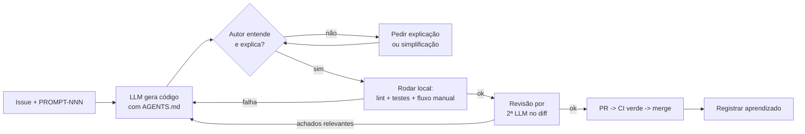

# Plano de Qualidade — Outfit Lab v1.0

| Campo | Valor |
|---|---|
| Documento | Plano de Gerenciamento da Qualidade |
| Versão | 1.2 |
| Data | 13/11/2026 |
| Autor | Cauã Gama Paixão |
| Gerado por | PROMPT-001 v2.0 |
| Status | Em revisão |
| Referências | PRD v1.1 · `04_Registro_de_Riscos.md` (RISK-10, 11, 14, 15) · `AGENTS.md` (Parte C) |

### Histórico de revisões

| Versão | Data | Autor | Alteração |
|---|---|---|---|
| 1.0 | 13/11/2026 | Cauã Gama Paixão | Versão inicial. |
| 1.1 | 13/11/2026 | Cauã Gama Paixão | Caminhos atualizados para a convenção de pastas D-25 e prompts previstos renumerados (+1) — PROMPT-002. |
| 1.2 | 13/11/2026 | Cauã Gama Paixão | Prompts previstos renumerados (+1) porque o PROMPT-003 passou a ser o das telas no Figma (D-33). |

---

## 1. Tailoring

Não há equipe de QA nem auditorias formais. A garantia da qualidade é feita por **automação** (CI, lint, testes), por **listas de verificação** curtas e por **revisão cruzada com uma segunda LLM**. A ferramenta concreta de lint, formatação e testes é definida no Guia de Kickoff Técnico (Parte C). Aqui fica apenas o **quê** e o **porquê**.

## 2. Política de qualidade

> "Pouco código, bem entendido e testado, vale mais do que muito código gerado." Cada entrega deve ser **funcional, explicável e verificável**.

## 3. Definição de Pronto (DoD)

### 3.1 Documento
- [ ] Cabeçalho completo (versão, data, autor, `Gerado por`, status, histórico).
- [ ] IDs cruzados com os demais documentos (RF, RISK, EAP, TELA…).
- [ ] Pontos não decididos marcados **[EM ABERTO]**, com recomendação e data.
- [ ] Informações voláteis com fonte ou **[VERIFICAR]**.
- [ ] Seção "📚 Por que este documento existe".
- [ ] Mermaid renderizando no GitHub.
- [ ] Índice (`b_doc_repo/README.md`) atualizado.

### 3.2 Tela (frontend)
- [ ] Segue a spec TELA-xx e o protótipo (tokens 60/30/10, tipografia, espaçamento).
- [ ] Todos os estados da spec implementados (RF-12): padrão, carregando, vazio, erro, validação, sucesso.
- [ ] Funciona em 375 px e 1440 px.
- [ ] Todo campo com `<label>`, foco visível, navegável por teclado; contraste AA.
- [ ] Mensagens de erro com o texto final da spec.
- [ ] Testes de componente para validações e estados críticos.
- [ ] Lint e formatação sem erros.

### 3.3 Endpoint (backend)
- [ ] Contrato igual ao OpenAPI (request, response, códigos de erro).
- [ ] Validação de entrada (Bean Validation) com mensagens claras.
- [ ] **Autorização por usuário:** o recurso é filtrado pelo usuário autenticado; acesso a recurso de outro usuário retorna 404 (sem revelar a existência).
- [ ] Teste de integração do caminho feliz + pelo menos 1 caminho de erro.
- [ ] **Teste de isolamento** (usuário B não acessa dado de A) para endpoints de peça, imagem, look e análise.
- [ ] Erros no formato padronizado; nenhum stack trace exposto.
- [ ] Logs sem dados sensíveis (senha, token, conteúdo de imagem).

### 3.4 Regra do avaliador
- [ ] Regra documentada (ID RN-xx, entrada, saída, peso, justificativa em texto para o usuário).
- [ ] Implementada como função/classe pura, sem dependência de Spring ou banco.
- [ ] Testes unitários: caso positivo, negativo e **dados ausentes**.
- [ ] Incluída em pelo menos 1 dos looks de exemplo com resultado esperado.
- [ ] Texto exibido ao usuário revisado (sem jargão e sem tom de "verdade universal").

### 3.5 Deploy
- [ ] CI verde no commit publicado.
- [ ] Migrations aplicadas sem erro; backup feito antes de migration que altera dados.
- [ ] Health check `UP` após o deploy.
- [ ] Fluxo de fumaça manual: login → guarda-roupa → (quando houver) análise.
- [ ] Segredos somente no painel do provedor; nada no repositório.
- [ ] Tag/Release criada quando for marco; CHANGELOG atualizado.
- [ ] Beta testers avisados, se houver indisponibilidade ou mudança visível.

## 4. Qualidade em vibe coding

### 4.1 Regra de ouro
**Nenhum commit de código que o autor não consiga explicar em uma frase.** Se não souber explicar, peça à LLM uma explicação linha a linha. Se ainda assim não entender, simplifique ou não faça o commit.

### 4.2 Ciclo de revisão de cada entrega da LLM

### 4.3 Regras
1. **Entregas pequenas:** 1 issue → 1 prompt → 1 PR. PRs com mais de ~400 linhas alteradas (excluindo arquivos gerados/lock) são divididos.
2. **Revisão dupla:** o autor revisa o diff inteiro, e uma **segunda LLM** (diferente da geradora, ou a mesma numa sessão nova, sem o contexto da geração) revisa com um prompt fixo de revisão: correção, segurança, isolamento por usuário, testes, simplicidade.
3. **Testes obrigatórios:**
   - todas as regras do avaliador (unitários);
   - isolamento de dados por usuário (integração);
   - validações de cadastro, login, peça e upload.
4. **Lint e formatação automáticos** no back e no front, rodando no CI. Ferramentas definidas na Parte C.
5. **CI bloqueia o merge** se build, lint ou testes falharem (branch protection na `main`).
6. **Prompt com limites:** todo prompt de código lista os arquivos que podem ser alterados e os testes esperados, o que reduz regressões (RISK-11).
7. **Sem dependência nova sem justificativa** escrita no PR.
8. **Não aceitar testes "verdes por construção"**: conferir se o teste falha quando a regra é quebrada (pelo menos 1 vez por regra do avaliador).

## 5. Checklist de segurança mínima

| # | Item | Como verificar | Ref. |
|---|---|---|---|
| SEG-01 | Senhas com hash forte (BCrypt ou Argon2), nunca em texto puro nem em log | Revisão de código + teste que confere o hash no banco | RNF-03 |
| SEG-02 | Segredos (DB, JWT/sessão, e-mail, storage) só em variáveis de ambiente; `.env` no `.gitignore`; `.env.example` sem valores | Revisão + secret scanning do GitHub | RISK-15 |
| SEG-03 | CORS restrito à origem do frontend em produção (sem `*`) | Teste manual com origem diferente | — |
| SEG-04 | Upload validado no servidor: tipo real do arquivo (não só a extensão), tamanho máximo, nome gerado pelo servidor | Testes de upload inválido | RNF-14, RISK-17 |
| SEG-05 | **Autorização por usuário em todos os endpoints** de peça, imagem, look e análise | Testes de isolamento (8.1) | RNF-04, RISK-14 |
| SEG-06 | HTTPS em produção | Acessar via `http://` redireciona ou falha | RNF-11 |
| SEG-07 | Mensagens de erro de login genéricas ("E-mail ou senha inválidos") | Teste | — |
| SEG-08 | Proteção básica contra força bruta no login (limite de tentativas) | **[EM ABERTO]**: Should, ~2 h; decidir no PROMPT-009 | — |
| SEG-09 | Dependências sem vulnerabilidades críticas conhecidas (Dependabot) | Alertas do GitHub | — |
| SEG-10 | Recuperação de senha (se implementada): token aleatório, uso único, expira em 30 min, resposta igual para e-mail existente ou não | Testes | 5.3 |

## 6. Métricas de qualidade

| Métrica | Meta | Como medir | Quando |
|---|---|---|---|
| CI verde na `main` | 100% dos commits | Histórico do GitHub Actions | Contínuo |
| Cobertura das regras do avaliador | 100% das regras com teste | Relatório de cobertura (JaCoCo) do pacote do avaliador | Por PR |
| Cobertura de linhas do backend | ≥ 60% (orientativo) | JaCoCo no CI | Por sprint |
| Endpoints com teste de isolamento | 100% dos endpoints de dados do usuário | Lista no OpenAPI × testes existentes | Por sprint |
| Rastreabilidade | 100% dos PRs com issue + PROMPT-NNN | Revisão dos PRs | Por sprint |
| Explicabilidade | 0 trechos não explicáveis no merge | Autoavaliação no checklist do PR | Por PR |
| Bugs no beta | Bugs críticos (perda de dados, falha de login, vazamento) = 0 abertos em 31/12 | Issues `bug` + `beta-feedback` | Semanal no beta |
| Tempo de triagem do feedback | ≤ 48 h | Data do formulário × data da issue | Semanal no beta |
| Acessibilidade | Lighthouse Accessibility ≥ 90 nas telas principais | Lighthouse no Chrome | M4 e M6 |
| Retrabalho por regressão | Registrar cada regressão causada por prompt | Label `regressao` | Por sprint |

---

## 📚 Por que este documento existe

Em vibe coding, **gerar** código é barato. Caro é descobrir depois que ele está errado, inseguro ou incompreensível. O Plano de Qualidade define o que significa "pronto" e coloca barreiras automáticas (CI, testes) e humanas (regra de ouro, revisão dupla) entre o código gerado e a `main`. É a principal resposta aos riscos RISK-10, RISK-11, RISK-14 e RISK-15.
