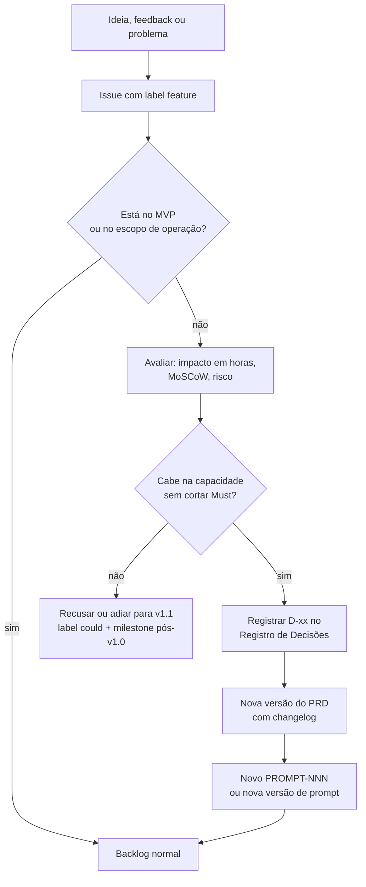

# Plano de Comunicação, Configuração e Beta — Outfit Lab v1.0

| Campo | Valor |
|---|---|
| Documento | Plano de Comunicação + Gerenciamento de Configuração e Mudanças + Plano do Beta |
| Versão | 1.2 |
| Data | 13/11/2026 |
| Autor | Cauã Gama Paixão |
| Gerado por | PROMPT-001 v2.0 |
| Status | Em revisão |
| Referências | `../b_iniciacao/02_Registro_de_Stakeholders.md` · `03_Cronograma_e_Marcos.md` · `05_Plano_de_Qualidade.md` |

### Histórico de revisões

| Versão | Data | Autor | Alteração |
|---|---|---|---|
| 1.0 | 13/11/2026 | Cauã Gama Paixão | Versão inicial. |
| 1.1 | 13/11/2026 | Cauã Gama Paixão | Caminhos atualizados para a convenção de pastas D-25 e prompts previstos renumerados (+1) — PROMPT-002. |
| 1.2 | 13/11/2026 | Cauã Gama Paixão | Prompts previstos renumerados (+1) porque o PROMPT-003 passou a ser o das telas no Figma (D-33). |

---

## Tailoring

Três planos do PMBOK (comunicação, configuração e mudanças) e o plano do beta ficaram num documento só, porque num projeto solo eles se sobrepõem: o GitHub é ao mesmo tempo canal de comunicação, sistema de configuração e registro de mudanças.

---

# Parte 1 — Comunicação

## 1.1 Matriz de comunicação

| Artefato/canal | Público | Conteúdo | Frequência | Responsável |
|---|---|---|---|---|
| **README raiz** (vitrine) | Recrutadores, professores, colegas | O que é, link do deploy, GIF/screenshots, stack, arquitetura, como rodar, status | Atualizado a cada marco | Autor |
| **`b_doc_repo/README.md`** (índice) | Autor, professores, LLMs | Mapa de documentos, prompts e protótipos com status | A cada novo artefato | Autor |
| **`CHANGELOG.md`** | Todos | Mudanças por versão (formato *Keep a Changelog*) | A cada release | Autor |
| **GitHub Projects** (Kanban) | Autor, recrutadores | Colunas: Backlog · Sprint atual · Em andamento · Em revisão · Pronto | Diário | Autor |
| **Issues com templates** | Autor, beta testers (indiretamente) | `bug`, `feature`, `beta-feedback` | Sob demanda | Autor |
| **Releases e tags** | Todos | Notas por marco (M1–M7) | A cada marco | Autor |
| **Relatório de sprint** (`d_execucao/SPR-xx.md`) | Autor, professores | Entregue × planejado, horas, riscos, decisões, aprendizados | Semanal | Autor |
| **Grupo de mensagens do beta** | Beta testers | Convites, novidades, manutenção, incidentes | Sob demanda (máx. 2 msgs/semana) | Autor |
| **Posts no LinkedIn** (opcional, Could) | Recrutadores, rede | Progresso, aprendizados com vibe coding, lançamento | M4, M6, M7 | Autor |

## 1.2 Templates de issue (criados no PROMPT-008)

| Template | Campos | Labels automáticas |
|---|---|---|
| Bug | O que aconteceu · o que era esperado · passos para reproduzir · navegador/dispositivo · print | `bug` |
| Feature | Problema · proposta · critério de aceite · pacote da EAP · PROMPT previsto · MoSCoW | `feature` |
| Feedback do beta | Origem (formulário/grupo) · resumo · tipo (bug/sugestão/dúvida/elogio) · severidade · beta tester (apelido, sem dados pessoais) | `beta-feedback` |

## 1.3 Labels sugeridas

`bug` · `feature` · `docs` · `design` · `infra` · `beta-feedback` · `regressao` · `seguranca` · `must` · `should` · `could` · `bloqueado` · `good-first-prompt` (tarefas simples para treinar prompts).

---

# Parte 2 — Configuração e mudanças

## 2.1 Estratégia de branches

| Critério | Trunk-based simplificado (`main` + `feature/*`) | Git-flow (`main`, `develop`, `feature/*`, `release/*`, `hotfix/*`) |
|---|---|---|
| Nº de branches de longa duração | 1 (`main`) | 2 (`main` + `develop`) |
| Custo para 1 dev | Baixo | Alto: merges duplos, releases manuais |
| Integração contínua | Natural: tudo converge para a `main` em horas/dias | Atrasada: `develop` acumula mudanças |
| Deploy automático | Simples: `main` = produção | Precisa de regras extras |
| Hotfix no beta | Branch `fix/*` → PR → `main` | Fluxo próprio de `hotfix/*` |
| Quando faz sentido | Times pequenos, deploy frequente | Várias versões em paralelo, releases agendadas |

**Recomendação: trunk-based simplificado.** Para um dev solo com prazo de 7 semanas, o git-flow só adiciona cerimônia. Regras:
- `main` sempre implantável e protegida (merge só via PR com CI verde).
- Branches curtas: `feature/<issue>-<slug>`, `fix/<issue>-<slug>`, `b_docs/<slug>`, `chore/<slug>`. Vida útil máxima: ~2 dias.
- PR mesmo trabalhando sozinho: é onde ficam a revisão da segunda LLM e o vínculo com issue e prompt (vale como portfólio).
- Merge por *squash* para manter um histórico limpo na `main`.

## 2.2 Versionamento (SemVer)

`MAJOR.MINOR.PATCH`:
- `0.x.y` até a v1.0 (API pode mudar): cada marco sobe o MINOR (`v0.1.0` = M1 … `v0.5.0` = M5), `v0.9.0-beta` = M6.
- `v1.0.0` = M7. Depois disso, correções do beta = PATCH (`v1.0.1`), novidades compatíveis = MINOR.
- Documentos usam versão própria (1.0, 1.1…) no cabeçalho; prompts também.

## 2.3 Conventional Commits

Formato: `tipo(escopo): descrição no imperativo` + rodapé com referências.

| Tipo | Uso |
|---|---|
| `feat` | Nova funcionalidade |
| `fix` | Correção de bug |
| `docs` | Documentação |
| `design` | Tokens, specs, protótipos (tipo customizado do projeto) |
| `test` | Testes |
| `refactor` | Mudança sem alterar comportamento |
| `chore` | Configuração, build, dependências |
| `ci` | Pipelines |

Escopos: `backend`, `frontend`, `db`, `infra`, `avaliador`, `contexto`, `iniciacao`, `planejamento`, `specs`, `prototipos`, `beta`.

Exemplo:
```
feat(backend): adiciona CRUD de peças com isolamento por usuário

Refs: #12
Prompt: PROMPT-010 v1.0
```

## 2.4 Controle de mudanças de escopo

Qualquer mudança que altere escopo, prazo ou uma decisão consolidada segue este fluxo:



Regras:
1. **Nada entra sem D-xx.** Decisão sem registro é decisão inventada.
2. Mudança de produto → nova versão do PRD (1.2, 1.3…). Mudança de processo → nova versão do documento de planejamento afetado.
3. Prompts não são editados depois de executados: mudanças viram uma nova versão (`v2.1`) ou um novo prompt.
4. A partir de **21/12 (M6)**, só entram mudanças do tipo `fix` ou `docs`. A partir de **28/12 (code freeze)**, só correções de bugs críticos.

---

# Parte 3 — Plano do beta

## 3.1 Objetivo do beta

Validar o fluxo principal com usuários reais, encontrar bugs que o autor não vê e coletar percepções sobre a utilidade da análise. Metas: OBJ-02 (≥ N amigos ativos, sugestão N = 5) e OBJ-03 (≥ 3 respostas de feedback).

## 3.2 Ondas e duração

| Onda | Início | Quem | O que testar | Pré-requisito |
|---|---|---|---|---|
| Onda 1 | 10/12 | 2–3 amigos mais próximos/técnicos | Cadastro, login, cadastro de peças com foto, guarda-roupa | Deploy (M4) + backup testado (9.4) + termos (2.3) |
| Onda 2 | 20–21/12 | Todos os convidados (sugestão: 8 no total) | Fluxo completo: peças → look → análise → salvar | Aceitação pré-beta (8.4) |

**Duração do beta: [EM ABERTO].** Recomendação: **de 10/12/2026 a 31/01/2027**. Motivo: as festas reduzem o uso no fim de dezembro, e janeiro dá tempo de uso real. A v1.0 é publicada em 30–31/12 normalmente; o beta continua sobre ela. Decidir até **07/12**.

## 3.3 Como convidar

1. Montar uma lista de 8 amigos com perfis variados (quem gosta de moda, quem não liga, alguém com celular Android e alguém com iPhone).
2. Pedir o e-mail que cada um vai usar e adicioná-lo à allowlist (`BETA_ALLOWED_EMAILS`) — se a allowlist for adotada (Declaração de Escopo, 6.6).
3. Enviar convite **individual** (mensagem pessoal converte mais que post em grupo) e depois adicionar a pessoa ao grupo do beta.

## 3.4 Mensagem-modelo de onboarding

> Oi, [nome]! Tô construindo o **Outfit Lab**, um app web pra organizar o guarda-roupa e montar looks, com uma análise que explica por que a combinação funciona (ou não). Queria muito que você testasse o beta. 🙌
>
> 🔗 Link: [URL]
> 📧 Use este e-mail no cadastro: [e-mail cadastrado na allowlist]
>
> **Em 10 minutos:**
> 1. Crie sua conta.
> 2. Cadastre pelo menos **5 peças** (foto de frente, num fundo simples, ajuda).
> 3. Monte **1 look** e veja a análise.
>
> Depois, me conta o que achou neste formulário de 3 minutos: [link do formulário]. Bug, dúvida ou "isso aqui é estranho" valem ouro.
>
> ⚠️ É uma versão **beta**: pode ter bugs, pode ficar fora do ar de vez em quando e os dados podem ser apagados no fim do beta (eu aviso antes). Seus dados não são compartilhados com ninguém. Detalhes na política de privacidade dentro do app.
>
> Valeu demais! 🖤💛

## 3.5 Canal e formulário de feedback

- **Canal síncrono:** grupo de mensagens do beta (dúvidas rápidas, avisos).
- **Canal estruturado:** formulário externo (Google Forms ou Tally [EM ABERTO], recomendação: Google Forms, gratuito e conhecido), com link fixo no app ("Dar feedback").
- **Perguntas do formulário (máx. 3 min):**
  1. De 0 a 10, quanto você usaria o Outfit Lab de novo? (NPS simplificado)
  2. O que foi mais fácil?
  3. Onde você travou ou se confundiu?
  4. A análise do look fez sentido? (Sim / Mais ou menos / Não) + por quê
  5. Encontrou algum erro? Descreva (e, se puder, mande print no grupo).
  6. Uma coisa que você mudaria.
- O formulário **não coleta dados pessoais** além de um apelido opcional.

## 3.6 Triagem do feedback em issues

1. A cada 48 h no máximo, o autor lê o formulário e o grupo.
2. Cada item vira uma issue com o template **Feedback do beta** (label `beta-feedback` + `bug`/`feature`).
3. Severidade:
   - **S1 crítico:** perda de dados, vazamento, login quebrado → corrigir em até 24 h, comunicar no grupo.
   - **S2 alto:** fluxo principal travado para alguém → próxima sprint/correção.
   - **S3 médio/baixo:** usabilidade, visual → avaliar com MoSCoW; pode ir para a v1.1.
   - **Sugestão de feature:** passa pelo controle de mudanças (2.4); o padrão é ir para a v1.1.
4. Fechar o ciclo: avisar no grupo o que foi corrigido ("Corrigi o bug do upload no iPhone que o X achou 🙏").

## 3.7 Comunicação de manutenção e incidentes

| Situação | Quando avisar | Mensagem-modelo |
|---|---|---|
| Manutenção planejada | ≥ 12 h antes | "🛠️ Amanhã, das [hora] às [hora], o Outfit Lab pode ficar fora do ar para atualização. Nenhum dado será perdido." |
| Incidente (app fora do ar) | Assim que perceber | "⚠️ O Outfit Lab está fora do ar. Já estou vendo. Aviso aqui quando voltar." → depois: "✅ Voltou! Causa: [resumo]." |
| Incidente com dados (S1) | Imediatamente após conter | Explicar o que aconteceu, quais dados foram afetados, o que foi feito e o que a pessoa precisa fazer (ex.: trocar a senha). |
| "Cold start" do plano gratuito | No onboarding | "Se o app demorar uns segundos para abrir na primeira vez, é normal: o servidor gratuito 'acorda'." [depende da hospedagem escolhida] |

## 3.8 Dados ao fim do beta — [EM ABERTO]

Opções:
- **A) Manter** as contas e os dados, que migram para a v1.0 normalmente (o beta e a v1.0 usam o mesmo banco).
- **B) Apagar** tudo ao fim do beta.
- **C) Perguntar** a cada beta tester (manter ou excluir) e excluir quem não responder em 15 dias.

**Recomendação: A + direito de exclusão.** Os dados ficam, porque apagar o guarda-roupa de quem gostou do app é desmotivador, e quem pedir tem a conta excluída em até 7 dias (processo da Declaração de Escopo, 6.8). Isso deve constar na política de privacidade (2.3). Se a hospedagem de produção mudar depois do beta, avisar com 15 dias de antecedência. Decidir até **07/12**, antes de redigir os termos.

---

## 📚 Por que este documento existe

Comunicação, configuração e beta parecem assuntos diferentes, mas respondem à mesma pergunta: **como mudanças chegam às pessoas sem causar caos?** Branches e commits organizam a mudança no código; o controle de escopo organiza a mudança no plano; e o plano do beta organiza como as mudanças chegam aos amigos, e como o feedback deles volta ao projeto.
