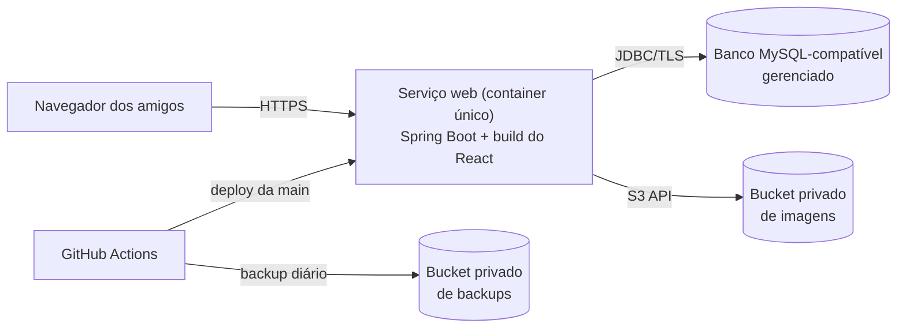
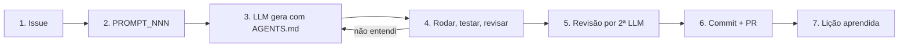
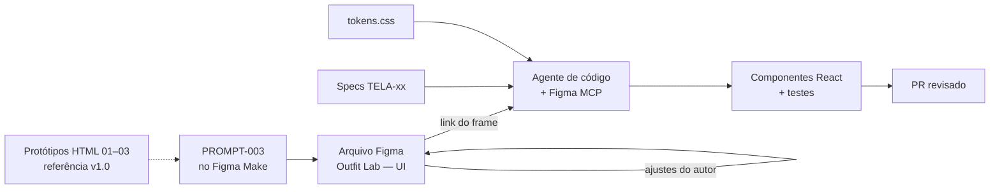

# Guia de Kickoff Técnico — Outfit Lab

| Campo | Valor |
|---|---|
| Documento | Decisões de stack, estrutura do `a_tech_repo/`, plano de deploy, CI/CD, observabilidade, GitHub como portfólio, fluxo de vibe coding (incluindo Figma ↔ React via MCP), backlog inicial e próximos prompts |
| Versão | 1.1 |
| Data | 13/11/2026 |
| Autor | Cauã Gama Paixão |
| Gerado por | PROMPT-001 v2.2 (Parte C2) |
| Referências | PRD v1.1 · Declaração de Escopo · EAP · Cronograma · Plano de Qualidade · Plano de Comunicação/Beta · Registro de Decisões · `c_design/*` · [`AGENTS.md`](../../../AGENTS.md) |
| Status | Em revisão |

### Histórico de revisões

| Versão | Data | Autor | Alteração |
|---|---|---|---|
| 1.0 | 13/11/2026 | Cauã Gama Paixão | Versão inicial. |
| 1.1 | 13/11/2026 | Cauã Gama Paixão | Prompts previstos renumerados (+1) com a criação do PROMPT-004 (frontend: setup + TELA-02). |

> **Sobre informações voláteis:** versões, planos gratuitos e limites foram pesquisados em 13/11/2026 em fontes secundárias, que muitas vezes se contradizem. Tudo que depende de preço ou limite está marcado **[VERIFICAR]**: confirme na página oficial do provedor antes de criar a conta (SPR-03). Fontes na seção 11.

---

## 1. Decisões de stack

### 1.1 Resumo

| Camada | Recomendação | Decisão |
|---|---|---|
| Frontend | React 19 + **Vite** + **TypeScript** · React Router · **TanStack Query** · React Hook Form + **Zod** · **CSS Modules + `tokens.css`** | D-32 (proposta) |
| Backend | **Java 25 (LTS)** · **Spring Boot 4.x** (última minor estável) · **Maven** · Spring Security com **sessão em cookie** · Spring Data JPA · **Flyway** · Bean Validation · springdoc-openapi · Actuator | D-29, D-31 (propostas) |
| Banco | **MySQL 8** via Docker Compose no ambiente local | D-04 |
| Imagens | Disco local (`./uploads`) no desenvolvimento · serviço de objetos compatível com S3 em produção · JPEG/PNG/WebP · máx. 5 MB | EA-07, EA-17 |
| Testes | JUnit (Jupiter) + Mockito + **Testcontainers** (MySQL) · Vitest + Testing Library · Playwright opcional (Could) | Plano de Qualidade |
| Design → código | **Figma** como fonte visual editável + **Figma MCP** para o agente ler os frames e gerar o React | D-33 (proposta) |

### 1.2 Frontend

| Tema | Recomendação | Por quê |
|---|---|---|
| Base | React 19 + Vite + TypeScript estrito (`"strict": true`) | Vite é o padrão atual para SPA (o Create React App foi descontinuado). TypeScript pega erros que a LLM introduz e documenta os contratos da API. |
| Node.js | Versão **LTS ativa** na data do setup (24 ou 26) **[VERIFICAR]** em nodejs.org | Suporte de longo prazo. |
| Roteamento | React Router (modo biblioteca, rotas declaradas em `src/app/router.tsx`) | O mais documentado; as LLMs geram bem. |
| Dados do servidor | TanStack Query | Cache, loading e erro prontos, que são justamente os estados do RF-12. Evita reinventar com `useEffect`. |
| Formulários | React Hook Form + Zod (o esquema Zod espelha as regras das specs) | Validação declarativa; as mensagens das specs ficam num lugar só. |
| Estilização | **CSS Modules + `tokens.css`** (recomendado) | Ver a comparação abaixo. |
| Lint e formatação | ESLint (flat config) + Prettier | Exigido pelo Plano de Qualidade. |

**CSS Modules × Tailwind**

| Critério | CSS Modules + tokens | Tailwind configurado com os tokens |
|---|---|---|
| Uso dos tokens já prontos | Direto: `var(--color-accent)` | Precisa mapear no tema (`@theme`) |
| Legibilidade para um estudante | CSS "normal", um arquivo por componente | Classes longas no JSX |
| Saída padrão do Figma MCP | Precisa traduzir (o MCP gera React + Tailwind por padrão) | Mais próxima |
| Risco de a LLM usar valores soltos | Médio (pode escrever HEX) — mitigado por lint | Médio (pode usar a paleta padrão do Tailwind) |
| Dependências | Nenhuma (nativo no Vite) | +1 dependência e configuração |

**Recomendação: CSS Modules.** Os tokens já existem como variáveis CSS, o código fica mais fácil de explicar em uma frase (regra de ouro do Plano de Qualidade) e a saída do Figma MCP é usada como **referência**, não colada: o agente traduz para os componentes e tokens do projeto (ver seção 7.2). Regra de lint: proibir HEX solto em `*.module.css` (stylelint `color-no-hex`), exceto em `tokens.css`.

### 1.3 Backend

| Tema | Recomendação | Por quê |
|---|---|---|
| Java | **25 (LTS, set/2025)** | LTS atual; suportada pelo Spring Boot 4. |
| Spring Boot | **4.x**, última minor estável no setup (4.1 em jun/2026; 4.2 prevista para nov/2026 **[VERIFICAR]**) | O PROMPT-001 pedia 3.x, mas o suporte open source do 3.5 terminou em 30/06/2026. Começar um projeto novo numa linha sem suporte não faz sentido (D-29). |
| Build | **Maven** | Mais exemplos e mais familiar no curso; o `pom.xml` é declarativo e fácil de revisar. Gradle seria mais rápido, mas não compensa aqui. |
| Persistência | Spring Data JPA + **Flyway** (`src/main/resources/db/migration/V1__...sql`) | Migrations versionadas; o schema nasce do mesmo jeito no local, no CI e na produção. `ddl-auto=validate`. |
| Validação | Bean Validation (`@Valid`) com as mesmas regras e mensagens das specs | Front e back validam igual. |
| Documentação | springdoc-openapi (Swagger UI só no perfil `local`) — compatibilidade com Boot 4 **[VERIFICAR]** na versão | Contrato visível; base do PROMPT-008. |
| Saúde | Spring Boot Actuator, expondo só `health` | RNF-13. |
| Pacotes | Por **funcionalidade**: `com.outfitlab.{auth, usuario, peca, imagem, look, avaliador, shared}`. O `avaliador` é **domínio puro** (sem Spring/JPA) | Testabilidade (RNF-10, EAP 7.2). |

### 1.4 Autenticação: JWT × sessão em cookie (EA-13)

| Critério | JWT no `localStorage` / header | **Sessão em cookie HttpOnly** |
|---|---|---|
| Exposição a XSS | Token legível por JS: alto risco | Cookie inacessível ao JS |
| Logout / revogar acesso | Difícil (token vale até expirar; precisa de lista de bloqueio) | Invalida a sessão no servidor |
| Complexidade no Spring | Filtro próprio, refresh token, rotação | Nativo no Spring Security |
| CSRF | Não se aplica | Precisa de token CSRF (nativo: `CookieCsrfTokenRepository`) |
| Front e API em domínios diferentes | Funciona | Exige `SameSite=None` + CORS com credenciais — mais frágil |
| "Lembrar de mim" | Refresh token longo | `remember-me` com tokens persistentes (nativo) |

**Recomendação (D-31): sessão em cookie, com front e API na mesma origem.** O build do React é servido pelo próprio Spring Boot (seção 3.1), então o navegador vê um único domínio: cookie `HttpOnly; Secure; SameSite=Lax`, CSRF por cookie + header `X-XSRF-TOKEN`, sem CORS em produção. A sessão fica no banco (**Spring Session JDBC**), para sobreviver a reinícios e ao "sono" do plano gratuito. "Lembrar de mim" = remember-me persistente de **30 dias**; sem ele, a sessão expira em **2 h** de inatividade. Isso resolve o EA-13 e o selo [EM ABERTO] da TELA-01.

### 1.5 Imagens

- **Formatos:** JPEG, PNG e WebP, validados pelo **conteúdo** (magic bytes), não só pela extensão. **Máx. 5 MB** (EA-07). Redimensionamento no cliente é Could.
- **Local:** pasta `./uploads` (fora do Git), servida por um endpoint que confere o dono.
- **Produção:** bucket **privado** compatível com S3. O backend usa o AWS SDK, então trocar de provedor é configuração. As imagens são servidas pela API (ou por URL assinada de curta duração), nunca por link público. Isso garante o isolamento por usuário (SEG, RNF-04).
- **Interface:** `ImageStorage` com duas implementações (`LocalImageStorage`, `S3ImageStorage`), escolhidas pelo perfil.

### 1.6 Testes

| Camada | Ferramenta | Obrigatório |
|---|---|---|
| Regras do avaliador | JUnit puro (sem Spring) | ✅ 100% das regras (Plano de Qualidade) |
| Isolamento por usuário | `@SpringBootTest` + Testcontainers (MySQL real) + MockMvc | ✅ todos os endpoints de peça, imagem, look e análise |
| Serviços | JUnit + Mockito | Quando houver regra |
| Componentes React | Vitest + Testing Library (+ `user-event`) | ✅ formulários e estados críticos |
| E2E | Playwright: cadastro → peça → look → análise → salvar | Could (EAP 8.3) |

## 2. Estrutura inicial do `a_tech_repo/`

Somente a árvore e os READMEs. **O código é gerado pelos próximos prompts** (PROMPT-009 em diante). Pastas de organização seguem a D-25; o interior dos projetos segue as convenções da stack.

```
a_tech_repo/
├── README.md
├── a_frontend/                  # projeto Vite (PROMPT-009)
│   ├── README.md
│   └── (gerado) package.json, vite.config.ts, index.html, public/,
│       src/
│       ├── app/                 # router, providers (QueryClient), AppShell
│       ├── pages/               # LoginPage, SignupPage, WardrobePage…
│       ├── components/          # Button, TextField, PieceCard… (das specs)
│       ├── features/            # auth/, pecas/, looks/ — hooks + chamadas à API
│       ├── lib/                 # apiClient (fetch + CSRF), utils
│       └── styles/              # tokens.css (cópia de c_design/b_tokens), global.css
├── b_backend/                   # projeto Maven (PROMPT-009)
│   ├── README.md
│   └── (gerado) pom.xml, src/main/java/com/outfitlab/{auth,usuario,peca,imagem,look,avaliador,shared}/,
│       src/main/resources/{application.yml, application-local.yml, application-prod.yml, db/migration/},
│       src/test/java/…
├── c_database/                  # documentação e scripts do banco (PROMPT-007)
│   └── README.md                # DER, dicionário de dados, seeds, backup/restore
└── d_infra/
    ├── README.md
    ├── a_scripts/               # validar_pastas.sh (+ backup.sh, restore.sh no PROMPT-013)
    └── (gerado) docker-compose.yml, Dockerfile, .env.example
```

> As migrations ficam em `b_backend/src/main/resources/db/migration/` (exigência do Flyway, exceção da D-25). A `c_database/` guarda a **documentação** do banco e os scripts operacionais.

## 3. Plano de deploy

### 3.1 Arquitetura de produção recomendada



**Um container só** (Dockerfile multi-estágio: `npm run build` → copia o `dist/` para `src/main/resources/static` → `mvn package` → imagem JRE 25). Vantagens: uma URL, sem CORS, cookies simples (seção 1.4), um deploy, uma única fonte de "sono" no plano gratuito.

### 3.2 Comparação de combinações (preços e limites **[VERIFICAR]**)

| | **A — Render + TiDB Cloud Starter + Cloudflare R2** (recomendada) | B — Render + Aiven MySQL (pago) + R2 | C — VPS gratuita (ex.: Oracle Cloud Always Free) + Docker Compose |
|---|---|---|---|
| App | Render Free Web Service (Docker) | Render Free | VPS ARM com Caddy (HTTPS automático) |
| Banco | TiDB Cloud Starter: **compatível com MySQL**, plano gratuito com cota de armazenamento e de "request units" (valores divergentes entre fontes) | Aiven for MySQL **Developer** (~US$ 5/mês); o plano grátis de MySQL foi **descontinuado** | MySQL 8 no próprio Compose |
| Imagens | Cloudflare R2 (cota gratuita de armazenamento; sem custo de saída) | R2 | Disco da VPS + backup no R2 |
| Custo | **R$ 0** | ~R$ 30/mês (no teto do EA-22) | R$ 0 (exige cartão no cadastro) |
| "Cold start" | Serviço dorme após ~15 min sem acesso; primeiro acesso leva dezenas de segundos | Igual | Sempre ligado |
| Facilidade | Alta (deploy por Git, HTTPS e subdomínio prontos) | Alta | **Baixa**: você vira administrador de servidor (atualizações, firewall, backup) |
| Risco principal | TiDB não é um MySQL "de verdade": alguma migration ou função pode se comportar diferente | Custo mensal | Operação e segurança da VPS; aprovação da conta |

**Recomendação (D-30): combinação A.** É a única com custo zero e pouca operação. Para reduzir o risco do TiDB: rodar as migrations contra o TiDB já no **primeiro deploy (SPR-03)** e evitar recursos específicos do MySQL (gatilhos, procedures, tipos espaciais). **Plano B:** se algo quebrar, migrar para a combinação B (só muda a URL do banco), dentro do teto de R$ 30/mês do EA-22.

**Sobre o "sono":** é aceito pela RNF-11 se for comunicado. A tela de login mostra "Acordando o servidor… isso pode levar até 1 minuto no primeiro acesso" quando a API demora mais que 3 s. Não usaremos "pings" para manter o serviço acordado sem antes ler os termos do provedor **[VERIFICAR]**.

### 3.3 Ambientes e variáveis

| Ambiente | Onde | Banco | Imagens | Perfil Spring |
|---|---|---|---|---|
| Local | Máquina do autor (`docker compose up` + `mvn spring-boot:run` + `npm run dev` com proxy do Vite para `/api`) | MySQL 8 no Docker | `./uploads` | `local` |
| CI | GitHub Actions | Testcontainers | temporário | `test` |
| Produção | Render | TiDB Cloud Starter | R2 | `prod` |

Variáveis de ambiente (documentadas em `d_infra/.env.example`, **sem valores reais**): `SPRING_PROFILES_ACTIVE`, `DB_URL`, `DB_USER`, `DB_PASSWORD`, `S3_ENDPOINT`, `S3_BUCKET`, `S3_ACCESS_KEY`, `S3_SECRET_KEY`, `BETA_ALLOWED_EMAILS`, `APP_BASE_URL`, `FEEDBACK_FORM_URL`. Segredos só no painel do provedor e nos *secrets* do GitHub (SEG).

- **HTTPS:** automático no subdomínio do provedor.
- **Domínio:** subdomínio gratuito na v1.0; domínio próprio é Could **[EM ABERTO] EA-18** (até 07/12/2026).
- **Backup durante o beta (RNF-12):** workflow agendado no GitHub Actions, diário, que faz `mysqldump` da produção, compacta, criptografa (`age` ou `gpg` com chave nos *secrets*) e envia para um bucket privado de backups no R2, com retenção de 7 dias. **Um teste de restauração** num MySQL local antes do beta (EAP 9.4). Conferir também se o TiDB oferece backup automático no plano gratuito **[VERIFICAR]**.

## 4. CI/CD com GitHub Actions

| Workflow | Gatilho | Passos |
|---|---|---|
| `ci.yml` | push e PR | 1) `validar_pastas.sh` (D-25) · 2) **front**: `npm ci`, lint, `tsc --noEmit`, Vitest, build · 3) **back**: `mvn -B verify` (testes + Testcontainers + JaCoCo) · 4) filtros por caminho (`paths`) para não rodar o back quando só o front mudou |
| `deploy.yml` | push na `main` com CI verde | Dispara o deploy no Render (deploy hook guardado nos *secrets*) |
| `backup.yml` | `schedule` diário + manual | Backup descrito na seção 3.3 |
| `pages.yml` | push na `main` que altere `b_doc_repo/c_design/d_prototipos/**` | Publica os protótipos no GitHub Pages via Actions (o Pages "por branch" só serve `/` ou `/docs`) |

`main` protegida: merge só por PR com o `ci.yml` verde (D-21, Plano de Qualidade).

## 5. Observabilidade mínima para o beta

- **Logs da API:** formato estruturado (JSON no perfil `prod`, suportado nativamente pelo Spring Boot), com id de requisição; **sem** senha, token ou conteúdo de imagem. Consultados no painel do Render.
- **Health check:** `/actuator/health` (só `status`), usado pelo Render e por um monitor externo gratuito de disponibilidade **[VERIFICAR]**.
- **Erros do frontend (Could):** `ErrorBoundary` com mensagem amigável + link "Dar feedback". Serviço externo de captura só se sobrar tempo.

## 6. GitHub como portfólio

- **README raiz:** badges (CI, licença, versão), GIF/screenshots das telas, link do deploy, stack, arquitetura (o Mermaid da seção 3.1), "Como rodar" em 3 comandos e link para a documentação.
- **Topics:** `react`, `typescript`, `vite`, `spring-boot`, `java`, `mysql`, `docker`, `vibe-coding`, `pmbok`, `figma`, `portfolio`.
- **GitHub Projects (Kanban):** Backlog → Pronto para prompt → Em andamento → Em revisão → Feito.
- **Labels:** as do Plano de Comunicação (`bug`, `feature`, `docs`, `design`, `infra`, `beta-feedback`, `must`, `should`, `could`…).
- **Milestones:** M1 a M7, com as datas do Cronograma.
- **GitHub Pages:** protótipos HTML em `/` (índice com links para as 3 telas e para o arquivo do Figma, se for público).

## 7. Fluxo de trabalho de vibe coding

### 7.1 Ciclo padrão (toda tarefa)



1. **Issue** com critério de aceite e label.
2. **`PROMPT_NNN`** em `b_doc_repo/a_prompts/` (objetivo, contexto, arquivos afetados, critérios de aceite, testes esperados).
3. **Gerar** com o agente usando o `AGENTS.md` como contexto.
4. **Rodar, testar e revisar.** Pedir à LLM que explique qualquer trecho não entendido. Regra de ouro: nenhum commit que você não consiga explicar em uma frase.
5. **Segunda LLM revisora** (outro modelo ou outra sessão, com o diff e a spec).
6. **Commit** em Conventional Commits, com rodapé `Refs: #<issue>` e `Prompt: PROMPT-NNN`; PR com CI verde.
7. **Lição aprendida** no Registro de Decisões (≤ 10 min por sprint).

### 7.2 Fluxo de telas: Figma ↔ React via MCP (D-33)

O objetivo é ter **flexibilidade para alterar o visual no Figma** e deixar o agente de código traduzir cada frame para React com os componentes e tokens do projeto.



**Papéis de cada fonte:**

| Fonte | É a verdade sobre… | Em caso de conflito |
|---|---|---|
| **Figma** (`Outfit Lab — UI`) | Visual: layout, espaçamento, hierarquia, ilustrações, variantes | Vence no visual, **desde que use os tokens** |
| **Specs `TELA-xx.md`** | Comportamento: campos, regras, textos de erro, estados, acessibilidade, props | Vence no comportamento e nos textos |
| **`tokens.css`** | Valores de cor, tipo, espaço, raio | Uma cor fora dos tokens no Figma é **erro de design**: o agente usa o token mais próximo e avisa |
| **Protótipos HTML** | Referência inicial (v1.0) e GitHub Pages | Não são mais atualizados depois que a tela existir no Figma |

**Setup (uma vez):**

1. Conta Figma com **assento que permita o uso do MCP**. Assentos de visualização têm limite muito baixo de chamadas por mês **[VERIFICAR]** o plano atual.
2. No Claude Code, adicionar o servidor remoto oficial: `claude mcp add --transport http figma https://mcp.figma.com/mcp` (ou o plugin oficial do Figma) e autenticar pelo navegador **[VERIFICAR]** o comando na documentação do Figma no dia do setup.
3. No Figma, criar as **variáveis** com os mesmos nomes dos tokens (`color/accent` ↔ `--color-accent`). O PROMPT-003 já pede isso.

**Por tela (Figma → React):**

1. Ajuste a tela no Figma e confira o checklist de entrega do PROMPT-003 (variáveis aplicadas, componentes nomeados como na spec, auto layout, frames 1440 e 375, estados).
2. Copie o **link do frame** (botão direito → *Copy link to selection*). O servidor remoto não enxerga a seleção do canvas, só links.
3. Abra uma issue e um prompt curto, por exemplo: *"Implemente a TELA-03 a partir de `<link desktop>` e `<link mobile>`, seguindo `c_design/c_specs/TELA-03_guarda_roupa.md`."*
4. O agente: lê o frame (contexto de design, variáveis e screenshot via MCP) → **mapeia** variáveis Figma → `var(--token)` → **reaproveita** componentes existentes em `src/components/` (cria só os que faltam, com os nomes da spec) → traduz a saída padrão do MCP (React + Tailwind) para **CSS Modules** → implementa estados e textos da spec → escreve os testes → compara visualmente com o screenshot do frame.
5. Revisão: paridade visual com o frame em 375 e 1440 px + DoD de tela do Plano de Qualidade.
6. Se o visual mudar depois, repita a partir do passo 1 com o link do frame alterado; o agente ajusta só o necessário.

**Regras para o agente** (também no `AGENTS.md`): nunca colar o código gerado pelo MCP sem adaptar; nunca escrever HEX solto; nunca baixar imagens de terceiros; ilustrações vêm do Figma como SVG exportado para `src/assets/`; divergência entre Figma e spec vira pergunta ao autor, não decisão silenciosa.

## 8. Backlog inicial (15 issues — SPR-00 a SPR-02)

| # | Título | Descrição | Critérios de aceite | Labels | Sprint | EAP | Prompt |
|---|---|---|---|---|---|---|---|
| 1 | Configurar GitHub como portfólio | Projects, labels, milestones M1–M7, templates de issue (bug, feature, feedback do beta), proteção da `main` | Board criado; 3 templates; `main` exige PR + CI | `infra`, `must` | SPR-00 | 1.2 | PROMPT-009 |
| 2 | Publicar protótipos 01–03 no GitHub Pages | Workflow `pages.yml` + índice | Link público abre as 3 telas | `design`, `infra`, `must` | SPR-00 | 11.2 | PROMPT-001 (C) |
| 3 | Gerar telas 01–03 no Figma | Rodar o PROMPT-003 no Figma Make, colar como camadas no arquivo `Outfit Lab — UI` e ajustar | Variáveis = tokens; componentes nomeados como nas specs; frames 1440/375 com todos os estados | `design`, `should` | SPR-00/01 | 3.4 | PROMPT-003 |
| 4 | Conectar o Figma MCP ao agente de código | Setup da seção 7.2 e teste com o frame da TELA-01 | Agente lê variáveis e screenshot de um frame por link | `infra`, `design`, `should` | SPR-01 | 3.4 | PROMPT-003 |
| 5 | Especificar requisitos e regras de negócio | RF/RNF/RN detalhados; taxonomia (EA-04), atributos (EA-05), cores (EA-06), camadas (EA-08), looks (EA-11) | Todo RF com critério de aceite testável; EAs resolvidos | `docs`, `must` | SPR-01 | 2.1 | PROMPT-005 |
| 6 | Modelar o banco (DER + dicionário) | `erDiagram` + dicionário em `c_database/` | Toda tabela de domínio chega ao usuário por FK | `docs`, `db`, `must` | SPR-01 | 4.1 | PROMPT-007 |
| 7 | Criar migrations e seeds | `V1__schema.sql`, seeds de categorias e cores | Schema sobe do zero no Docker e no CI | `db`, `must` | SPR-01 | 4.2 | PROMPT-007 |
| 8 | Definir contratos da API (OpenAPI) | `openapi.yaml`, formato único de erro, pacotes | Todos os endpoints do MVP com request/response/erros | `docs`, `backend`, `must` | SPR-01 | 2.2 | PROMPT-008 |
| 9 | Setup do backend Spring Boot | Projeto Maven, perfis, conexão MySQL, Flyway, `/actuator/health` | `mvn verify` verde; health `UP` local | `backend`, `must` | SPR-01 | 5.1 | PROMPT-009 |
| 10 | Setup do frontend React | Vite + TS, tokens, rotas, `AuthLayout`, `AppShell`, proxy `/api` | Build e lint sem erro; layouts em 375/1440 | `frontend`, `must` | SPR-01 | 6.1 | PROMPT-009 |
| 11 | Docker Compose local | MySQL 8 + `.env.example` | `docker compose up` sobe o banco | `infra`, `must` | SPR-01 | 9.1 | PROMPT-009 |
| 12 | CI no GitHub Actions | `ci.yml` (seção 4) | PR com teste falhando fica bloqueado | `infra`, `must` | SPR-02 | 9.2 | PROMPT-009 |
| 13 | Autenticação e cadastro no backend | Sessão em cookie, CSRF, BCrypt, allowlist do beta, remember-me | Testes de cadastro válido/inválido, login, logout e acesso negado | `backend`, `must` | SPR-02 | 5.2 | PROMPT-010 |
| 14 | Telas de login e cadastro (React) | TELA-01/02 a partir dos frames do Figma + specs | Estados e textos da spec; testes de componente | `frontend`, `must` | SPR-02 | 6.2 | PROMPT-010 |
| 15 | CRUD de peças + upload | Endpoints com validação por categoria; `ImageStorage` local | Isolamento por usuário testado; upload inválido → 400 | `backend`, `must` | SPR-02 | 5.4, 5.5 | PROMPT-011 |

> Impacto do fluxo com Figma (issues 3 e 4): **~3 h**, classificado como **Should**. Cabe na folga da SPR-00/01; se faltar tempo, as telas 01–03 são codificadas direto a partir dos protótipos HTML e o Figma entra a partir das telas 04–09.

## 9. Próximos prompts

| Prompt | Título | Objetivo | Sprint |
|---|---|---|---|
| PROMPT-003 | Telas no Figma | Gerar no Figma Make as telas 01–03 (base para o fluxo Figma → React) | SPR-00/01 |
| PROMPT-005 | Requisitos e regras de negócio | RF/RNF/RN detalhados com critérios de aceite; fechar EA-04, 05, 06, 08, 11 | SPR-01 |
| PROMPT-006 | Telas restantes | Specs + telas 04–09 (dashboard, cadastro de peça, montador, resultado, looks salvos, perfil), **no Figma** (extensão do PROMPT-003) | SPR-03 |
| PROMPT-007 | Modelagem de dados | DER, dicionário, migrations e seeds | SPR-01 |
| PROMPT-008 | Arquitetura e contratos da API | Diagrama de componentes, pacotes, `openapi.yaml` | SPR-01 |
| PROMPT-009 | Setup do monorepo | React + Spring Boot + Docker + CI + GitHub | SPR-01/02 |
| PROMPT-010 | Autenticação | Back (sessão, CSRF, allowlist) + TELA-01/02 via Figma MCP | SPR-02 |
| PROMPT-011 | CRUD de peças + upload | Back + TELA-03/05 via Figma MCP | SPR-02/03 |
| PROMPT-012 | Avaliador v1 | Regras, motor, testes, endpoint | SPR-04 |
| PROMPT-013 | Deploy e beta | Render + TiDB + R2, backup, health, onboarding | SPR-03/05 |

## 10. Decisões e pontos em aberto desta parte

| Tipo | Item | Recomendação | Prazo |
|---|---|---|---|
| Decisão proposta | **D-29** Spring Boot 4.x + Java 25 (em vez de 3.x) | Adotar | Revisão deste guia |
| Decisão proposta | **D-30** Deploy: container único no Render + TiDB Cloud Starter + Cloudflare R2; plano B Aiven pago | Adotar | 16/11/2026 |
| Decisão proposta | **D-31** Sessão em cookie, mesma origem, Spring Session JDBC, remember-me 30 dias (resolve EA-13) | Adotar | 16/11/2026 |
| Decisão proposta | **D-32** Frontend: Vite + TS + React Router + TanStack Query + RHF/Zod + CSS Modules | Adotar | 16/11/2026 |
| Decisão proposta | **D-33** Figma como fonte visual editável + fluxo Figma MCP → React (seção 7.2) | Adotar | 16/11/2026 |
| Resolvido (proposta) | EA-07 (imagens), EA-13 (auth), EA-16 (hospedagem), EA-17 (imagens em produção), EA-22 (custo R$ 0, plano B ≤ R$ 30) | Ver seções 1.4, 1.5 e 3 | 16/11/2026 |
| [EM ABERTO] | EA-18 domínio próprio | Subdomínio gratuito na v1.0 | 07/12/2026 |
| [VERIFICAR] | Limites gratuitos de Render, TiDB Cloud Starter e R2; versão do Spring Boot e do Node no setup; compatibilidade springdoc × Boot 4; plano/assento do Figma para o MCP; comando de setup do MCP | Conferir nas páginas oficiais | Antes do PROMPT-009 / SPR-03 |

## 11. Fontes consultadas (13/11/2026)

- Figma MCP: [Figma MCP Server Guide (README oficial)](https://cdn.jsdelivr.net/gh/figma/mcp-server-guide@main/README.md) · [Conector Figma do Claude](https://claude.com/connectors/figma-8ef5e4) · [Guia Figma MCP + Claude Code](https://vibecodingacademy.ai/blog/figma-mcp-claude-code-complete-guide) · [Fórum Figma — limite por plano](https://forum.figma.com/report-a-problem-6/dev-mode-mcp-server-not-accessible-professional-plan-56934)
- Figma Make: [Central de ajuda — copiar como camadas de design](https://help.figma.com/hc/en-us/articles/31304485164695) · [Design to code com Figma Make](https://www.figma.com/solutions/design-to-code/)
- Spring Boot e Java: [Spring Boot 4.1 — requisitos](https://docs.spring.io/spring-boot/4.1/system-requirements.html) · [Datas de fim de suporte do Spring Boot](https://www.herodevs.com/blog-posts/spring-boot-versions-eol-dates-and-latest-releases-april-2026) · [Spring 7 / Boot 4 (InfoQ)](https://www.infoq.com/news/2025/11/spring-7-spring-boot-4)
- Hospedagem: [Comparação de planos gratuitos (set/2026)](https://flaviocopes.com/hosting-free-tiers/) · [Render — plataformas com plano gratuito em 2026](https://render.com/articles/platforms-with-a-real-free-tier-for-developers-in-2026)
- Banco: [Aiven — fim do MySQL gratuito](https://aiven.io/free-mysql-database-retired) · [Comparação de hospedagem MySQL 2026](https://www.bytebase.com/blog/mysql-hosting-options-pricing-comparison/) · [TiDB Cloud Starter (antigo Serverless)](https://www.issoh.co.jp/tech/details/7541/)

---

## 📚 Por que este documento existe

Em vibe coding, a LLM escreve o código, mas quem decide a arquitetura é você. Este guia fecha as decisões que, se ficassem abertas, a LLM tomaria sozinha a cada prompt, e de jeitos diferentes: biblioteca de formulário, onde fica o token de login, como a tela do Figma vira componente. Também deixa o caminho até o deploy visível desde o primeiro dia, para que o beta com os amigos não dependa de uma surpresa de hospedagem na última semana.
