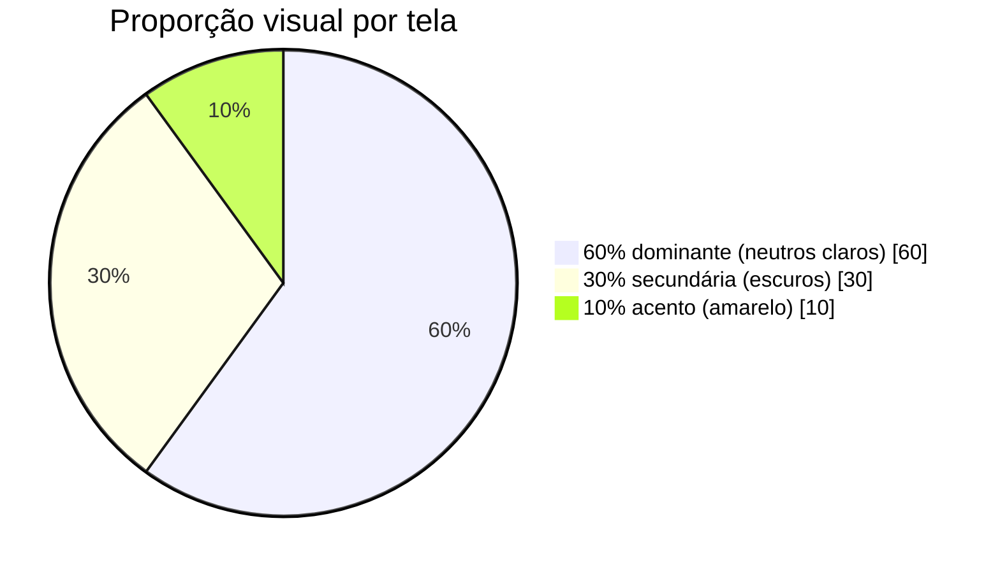

# Design Tokens — Outfit Lab

| Campo | Valor |
|---|---|
| Documento | Design tokens: cores (regra 60/30/10), tipografia, espaçamento, raios, sombras, foco e breakpoints |
| Versão | 1.0 |
| Data | 13/11/2026 |
| Autor | Cauã Gama Paixão |
| Gerado por | PROMPT-001 v2.1 (Parte B2) |
| Arquivos | [`tokens.css`](tokens.css) · [`tokens.ts`](tokens.ts) |
| Status | Em revisão |

### Histórico de revisões

| Versão | Data | Autor | Alteração |
|---|---|---|---|
| 1.0 | 13/11/2026 | Cauã Gama Paixão | Versão inicial. |

---

## 1. Como usar

- **Componentes usam só os tokens semânticos** (`--color-text`, `--color-accent`…), nunca a paleta base (`--palette-*`) nem HEX solto. Trocar uma cor passa a ser uma mudança de uma linha.
- `tokens.css` é a fonte de verdade para estilos; `tokens.ts` espelha os mesmos valores para uso em JS/TS. Quem alterar um, altera o outro no mesmo commit.
- No React: `import './tokens.css'` no `main.tsx`; nos componentes, `var(--color-accent)` (CSS Modules) ou `tokens.color.accent` (TS).

## 2. Cores — regra 60/30/10 (D-18)

### 2.1 60% — dominante (fundo / respiro)

| Token | Valor | Uso |
|---|---|---|
| `--color-bg` | `#FAFAFA` | Fundo das páginas |
| `--color-surface` | `#FFFFFF` | Cards, inputs, modais, painel de formulário |
| `--color-image` | `#F2F2F2` | Fundo da área de imagem dos cards |

### 2.2 30% — secundária (estrutura / texto / contraste)

| Token | Valor | Uso | Contraste |
|---|---|---|---|
| `--color-text` | `#0A0A0A` | Texto principal, ícones | 18,97:1 sobre `bg` ✅ |
| `--color-text-strong` | `#1F1F1F` | Títulos alternativos, chips ativos | 15,79:1 ✅ |
| `--color-text-muted` | `#6B6B6B` | Texto secundário, placeholders, contagens | 5,11:1 sobre `bg`, 5,33:1 sobre `surface`, 4,76:1 sobre `image` ✅ (AA; ≥ 14 px sobre `image`) |
| `--color-border` | `#E5E5E5` | Divisores, borda de cards (decorativo) | 1,26:1 — **não** usar como limite de input |
| `--color-border-strong` | `#8A8A8A` | Borda de inputs, selects, checkbox | 3,45:1 sobre `surface` ✅ (WCAG 1.4.11) |
| `--color-inverse-bg` | `#0A0A0A` | Sidebar, painel editorial do auth | — |
| `--color-inverse-surface` | `#1F1F1F` | Cards e itens hover sobre o painel escuro | — |
| `--color-inverse-text` | `#FFFFFF` | Texto sobre painel escuro | 19,8:1 ✅ |
| `--color-inverse-muted` | `#A3A3A3` | Texto secundário sobre painel escuro | 7,85:1 sobre `#0A0A0A`, 6,53:1 sobre `#1F1F1F` ✅ |

### 2.3 10% — acento (ação e destaque)

| Token | Valor | Uso | Contraste |
|---|---|---|---|
| `--color-accent` | `#FACC15` | CTA principal, item de navegação ativo, halo de foco, badges, indicador de pontuação | Texto `#0A0A0A` sobre ele: 12,93:1 ✅ |
| `--color-accent-hover` | `#EAB308` | Hover/pressionado do CTA | Texto `#0A0A0A`: 10,32:1 ✅ |
| `--color-on-accent` | `#0A0A0A` | Texto e ícones sobre o amarelo | — |

> ⚠️ **Proibido:** amarelo como **texto** ou ícone fino sobre fundo claro (1,47:1 ❌) e amarelo em **grandes áreas** (fundo de seção, header inteiro). Sobre fundo **escuro**, o amarelo pode ser texto/ícone (12,93:1 ✅), como o ponto do item ativo na sidebar.

### 2.4 Feedback

| Token | Valor | Uso | Contraste |
|---|---|---|---|
| `--color-danger` | `#B91C1C` | Mensagens de erro, borda de input inválido | 6,47:1 sobre `surface` ✅ |
| `--color-danger-bg` | `#FEF2F2` | Fundo de alerta de erro | Texto `danger` sobre ele: 5,91:1 ✅ |
| `--color-success` | `#15803D` | Mensagens de sucesso, indicador de força "forte" | 5,02:1 sobre `surface` ✅ |
| `--color-success-bg` | `#F0FDF4` | Fundo de alerta de sucesso | Texto `success`: 4,79:1 ✅ |

Erro e sucesso **nunca dependem só da cor**: sempre há ícone e texto (WCAG 1.4.1).

## 3. Tipografia

Fonte **Inter** (Google Fonts), pesos 400, 500, 600, 700 e 800. Fallback: `system-ui, -apple-system, "Segoe UI", Roboto, sans-serif`.

| Token | Tamanho / linha | Peso | Uso |
|---|---|---|---|
| `display` | 40 / 48 | 700, tracking −0,02em | Título editorial de página no desktop ("Guarda-roupa") |
| `h1` | 32 / 40 | 600 | Título de página (mobile usa `h1` no lugar de `display`) |
| `h2` | 24 / 32 | 600 | Título de seção, título do formulário |
| `h3` | 18 / 24 | 500 | Título de card, subtítulos |
| `body` | 16 / 24 | 400 | Texto corrido, valor de inputs (16 px evita zoom automático no iOS) |
| `caption` | 14 / 20 | 400 | Texto auxiliar, mensagens de erro, metadados |
| `label` | 14 / 20 | 500 | Labels de campos (mínimo 13 px — E5) |
| `overline` | 12 / 16 | 600, MAIÚSCULAS, tracking 0,08em | Eyebrow ("COLEÇÃO PESSOAL"), selos |

**Logo:** "Outfit" / "Lab" empilhado, Inter 800, tracking −0,03em, `line-height` 0,95.

## 4. Espaçamento (escala de 4 px)

| Token | px | Uso típico |
|---|---|---|
| `--space-1` | 4 | Ícone ↔ texto |
| `--space-2` | 8 | Label ↔ input, entre chips |
| `--space-3` | 12 | Padding interno de chips |
| `--space-4` | 16 | Padding de cards, margem lateral mobile |
| `--space-5` | 20 | Entre campos de formulário |
| `--space-6` | 24 | Gap do grid de cards |
| `--space-8` | 32 | Margem lateral desktop, entre blocos |
| `--space-10` | 40 | Padding do painel editorial |
| `--space-12` | 48 | Entre seções |
| `--space-16` | 64 | Topo de página editorial |
| `--space-20` | 80 | Respiro máximo (desktop largo) |

## 5. Raios, sombras e foco

| Token | Valor | Uso |
|---|---|---|
| `--radius-input` | 8 px | Inputs, selects, botões |
| `--radius-card` | 12 px | Cards, painéis, modais |
| `--radius-pill` | 999 px | Chips, selos, botão "+" |
| `--shadow-sm` | `0 1px 2px rgba(10,10,10,.06)` | Cards em repouso |
| `--shadow-md` | `0 4px 16px rgba(10,10,10,.08)` | Card em hover, menus |
| `--shadow-lg` | `0 12px 32px rgba(10,10,10,.14)` | Barra flutuante, modais |
| `--focus-ring` | contorno `#0A0A0A` 2 px + halo `#FACC15` até 5 px | Todo elemento focável via `:focus-visible` (E10) |

O estilo é **flat**: sombra só para indicar elevação real (flutuante, hover, modal).

## 6. Tamanhos e breakpoints

| Token | Valor |
|---|---|
| `--size-touch` / `--size-input` | 48 px (mínimo 44 px) |
| `--size-sidebar` | 248 px |
| `--size-bottom-nav` | 64 px |
| `--size-content-max` | 1200 px |

| Breakpoint | min-width | Layout |
|---|---|---|
| `sm` | 375 px | Base mobile: 1 coluna, navegação inferior, grid de 2 cards |
| `md` | 768 px | Grid de 3 cards; auth ainda em 1 coluna com cabeçalho editorial |
| `lg` | 1024 px | Auth em 2 colunas; sidebar fixa; grid de 3 cards |
| `xl` | 1440 px | Grid de 4 cards; respiro máximo |

## 7. Componentes base e uso dos tokens

| Componente | Repouso | Hover | Foco | Desabilitado |
|---|---|---|---|---|
| Botão primário | fundo `accent`, texto `on-accent`, 600 | fundo `accent-hover` | `focus-ring` | opacidade 0,5, cursor `not-allowed` |
| Botão secundário | fundo `surface`, borda `text`, texto `text` | fundo `image` | `focus-ring` | idem |
| Botão escuro | fundo `inverse-bg`, texto `inverse-text` | fundo `inverse-surface` | `focus-ring` | idem |
| Input | fundo `surface`, borda 1 px `border-strong` | borda `text-strong` | `focus-ring` + borda `text` | fundo `image` |
| Input inválido | borda 2 px `danger` + ícone + mensagem `caption` `danger` | — | `focus-ring` | — |
| Chip | fundo `surface`, borda `border` | borda `text-strong` | `focus-ring` | — |
| Chip ativo | fundo `inverse-bg`, texto `inverse-text` | — | `focus-ring` | — |
| Nav item ativo (sidebar) | texto `inverse-text` + ponto `accent` | — | `focus-ring` | — |

---

## 📚 Por que este documento existe

Tokens são o contrato entre o design e o código. Sem eles, cada tela gerada pela LLM traria um cinza diferente e um amarelo usado onde não deve. Com papéis semânticos, a regra 60/30/10 e os contrastes medidos ficam garantidos por construção: quem usa `--color-accent` sabe para que ele serve, e quem revisa o código procura HEX solto como sinal de erro.
